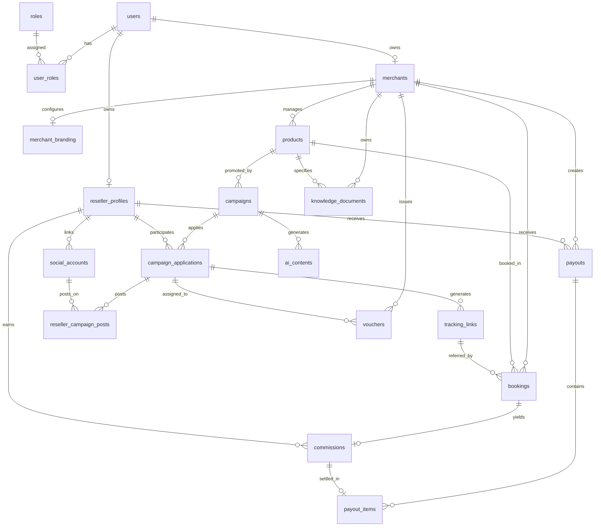

# TÀI LIỆU THIẾT KẾ DATABASE SCHEMA (DATABASE_SCHEMA.md)

**Hệ thống:** AI Travel Reseller Network Platform  
**RDBMS:** PostgreSQL 15+  
**Schema quản lý:** `travel_v2` (quản trị bởi Flyway Migration)  
**ORM:** Hibernate 7.4.5 / Spring Data JPA (Java 17, Spring Boot 4.1.1)  
**Trạng thái:** Hoàn thiện 19 bảng nghiệp vụ chuẩn hóa + 2 bảng hỗ trợ Platform Admin  

---

## 1. TỔNG QUAN CẤU TRÚC 19 BẢNG MỤC TIÊU

Hệ thống được tổ chức thành 4 nhóm nghiệp vụ chính:

---

## 2. CHI TIẾT 19 BẢNG NGHIỆP VỤ THEO NHÓM

### NHÓM 1: TENANT, MERCHANT, TÀI KHOẢN VÀ PHÂN QUYỀN

#### 1. Bảng `roles` (Vai trò trong hệ thống)
| Tên cột | Kiểu dữ liệu | Thuộc tính / Ràng buộc | Ý nghĩa nghiệp vụ |
|---|---|---|---|
| `id` | `UUID` | PK, DEFAULT `gen_random_uuid()` | Định danh duy nhất vai trò. |
| `name` | `VARCHAR(100)` | NOT NULL, UNIQUE | Tên vai trò (ví dụ: `ROLE_ADMIN`, `ROLE_MERCHANT`, `ROLE_RESELLER`). |
| `scope` | `VARCHAR(50)` | NOT NULL | Phạm vi vai trò (`GLOBAL`, `PLATFORM`, `TENANT`). |
| `description` | `TEXT` | NULL | Mô tả quyền hạn và chức năng vai trò. |
| `created_at` | `TIMESTAMPTZ` | NOT NULL, DEFAULT `NOW()` | Thời điểm tạo bản ghi. |
- **Ràng buộc:** `CONSTRAINT uq_roles_id_scope UNIQUE (id, scope)`.

#### 2. Bảng `users` (Tài khoản người dùng toàn nền tảng)
| Tên cột | Kiểu dữ liệu | Thuộc tính / Ràng buộc | Ý nghĩa nghiệp vụ |
|---|---|---|---|
| `id` | `UUID` | PK, DEFAULT `gen_random_uuid()` | Định danh người dùng. |
| `email` | `VARCHAR(255)` | NOT NULL | Email đăng nhập. |
| `password_hash` | `VARCHAR(255)` | NOT NULL | Mật khẩu băm (BCrypt), trường nhạy cảm, không serialize ra API. |
| `full_name` | `VARCHAR(255)` | NOT NULL | Họ và tên người dùng. |
| `phone` | `VARCHAR(50)` | NULL | Số điện thoại liên hệ (giữ nguyên số 0 và mã quốc gia). |
| `status` | `VARCHAR(30)` | NOT NULL, DEFAULT `'ACTIVE'` | Trạng thái: `ACTIVE`, `LOCKED`, `PENDING_VERIFICATION`, `DISABLED`. |
| `email_verified_at` | `TIMESTAMPTZ` | NULL | Thời điểm xác thực email thành công qua OTP/Link. |
| `created_at` | `TIMESTAMPTZ` | NOT NULL, DEFAULT `NOW()` | Thời điểm tạo tài khoản. |
| `updated_at` | `TIMESTAMPTZ` | NOT NULL, DEFAULT `NOW()` | Thời điểm cập nhật cuối cùng (tự động cập nhật qua trigger). |
- **Chỉ mục:** `CREATE UNIQUE INDEX uq_users_email_lower ON users (LOWER(email))` (không phân biệt hoa/thường).
- **Ràng buộc CHECK:** `CHECK (status IN ('ACTIVE', 'LOCKED', 'PENDING_VERIFICATION', 'DISABLED'))`.

#### 3. Bảng `user_roles` (Bảng nối người dùng và vai trò phạm vi GLOBAL)
| Tên cột | Kiểu dữ liệu | Thuộc tính / Ràng buộc | Ý nghĩa nghiệp vụ |
|---|---|---|---|
| `user_id` | `UUID` | FK -> `users(id)` ON DELETE RESTRICT | Người dùng được gán quyền. |
| `role_id` | `UUID` | FK -> `roles(id)` ON DELETE RESTRICT | Vai trò được gán. |
| `role_scope` | `VARCHAR(50)` | NOT NULL, DEFAULT `'GLOBAL'` | Đảm bảo vai trò được gán ở cấp toàn nền tảng. |
| `created_at` | `TIMESTAMPTZ` | NOT NULL, DEFAULT `NOW()` | Thời điểm gán vai trò. |
- **Khóa chính:** `PRIMARY KEY (user_id, role_id)`.
- **Ràng buộc FK tổng hợp:** `FOREIGN KEY (role_id, role_scope) REFERENCES roles(id, scope)`.
- **Ràng buộc CHECK:** `CHECK (role_scope = 'GLOBAL')`.

#### 4. Bảng `merchants` (Doanh nghiệp đối tác / Tenant)
| Tên cột | Kiểu dữ liệu | Thuộc tính / Ràng buộc | Ý nghĩa nghiệp vụ |
|---|---|---|---|
| `id` | `UUID` | PK, DEFAULT `gen_random_uuid()` | Định danh tenant/merchant. |
| `user_id` | `UUID` | FK -> `users(id)` ON DELETE RESTRICT | Tài khoản chủ sở hữu doanh nghiệp. |
| `code` | `VARCHAR(100)` | NOT NULL, UNIQUE | Mã định danh doanh nghiệp (viết hoa, không dấu). |
| `name` | `VARCHAR(255)` | NOT NULL | Tên hiển thị của doanh nghiệp. |
| `description` | `TEXT` | NULL | Giới thiệu doanh nghiệp. |
| `contact_email` | `VARCHAR(255)` | NOT NULL | Email liên hệ hỗ trợ khách hàng. |
| `phone` | `VARCHAR(50)` | NULL | Hotline/Số điện thoại kinh doanh. |
| `address` | `TEXT` | NULL | Địa chỉ trụ sở doanh nghiệp. |
| `subdomain` | `VARCHAR(100)` | NOT NULL | Subdomain riêng biệt của tenant trên platform. |
| `custom_domain` | `VARCHAR(255)` | NULL | Tên miền riêng của doanh nghiệp. |
| `status` | `VARCHAR(20)` | NOT NULL, DEFAULT `'ACTIVE'` | Trạng thái: `ACTIVE`, `SUSPENDED`, `PENDING`, `CLOSED`. |
| `version` | `BIGINT` | NOT NULL, DEFAULT `0` | Khóa lạc quan (Optimistic Lock) cho quản trị viên cập nhật. |
| `created_at` | `TIMESTAMPTZ` | NOT NULL, DEFAULT `NOW()` | Thời điểm đăng ký tenant. |
| `updated_at` | `TIMESTAMPTZ` | NOT NULL, DEFAULT `NOW()` | Thời điểm cập nhật cuối (tự động qua trigger). |
- **Chỉ mục UNIQUE:** `uq_merchants_subdomain_lower` trên `LOWER(subdomain)`; `uq_merchants_custom_domain_lower` trên `LOWER(custom_domain)` WHERE `custom_domain IS NOT NULL`.

#### 5. Bảng `merchant_branding` (Cấu hình nhận diện thương hiệu Tenant)
| Tên cột | Kiểu dữ liệu | Thuộc tính / Ràng buộc | Ý nghĩa nghiệp vụ |
|---|---|---|---|
| `id` | `UUID` | PK, DEFAULT `gen_random_uuid()` | Định danh bản ghi branding. |
| `merchant_id` | `UUID` | NOT NULL, UNIQUE, FK -> `merchants(id)` | Liên kết 1-1 với doanh nghiệp. |
| `logo_url` | `TEXT` | NULL | Đường dẫn ảnh logo. |
| `favicon_url` | `TEXT` | NULL | Đường dẫn favicon trình duyệt. |
| `primary_color` | `VARCHAR(20)` | DEFAULT `'#0B7F7B'` | Mã màu chủ đạo (HEX). |
| `secondary_color` | `VARCHAR(20)` | DEFAULT `'#F4B63F'` | Mã màu phụ/nhấn (HEX). |
| `custom_css` | `TEXT` | NULL | Mã CSS tùy biến giao diện tenant. |
| `footer_text` | `TEXT` | NULL | Nội dung bản quyền chân trang. |
| `updated_at` | `TIMESTAMPTZ` | NOT NULL, DEFAULT `NOW()` | Thời điểm cập nhật cuối (tự động qua trigger). |

#### 6. Bảng `reseller_profiles` (Hồ sơ người bán lại / Affiliate Reseller)
| Tên cột | Kiểu dữ liệu | Thuộc tính / Ràng buộc | Ý nghĩa nghiệp vụ |
|---|---|---|---|
| `id` | `UUID` | PK, DEFAULT `gen_random_uuid()` | Định danh hồ sơ reseller. |
| `user_id` | `UUID` | NOT NULL, UNIQUE, FK -> `users(id)` | Liên kết 1-1 với tài khoản cá nhân. |
| `payout_info` | `JSONB` | NOT NULL, DEFAULT `'{}'::jsonb` | Thông tin tài khoản ngân hàng nhận tiền (nhạy cảm). |
| `status` | `VARCHAR(20)` | NOT NULL, DEFAULT `'ACTIVE'` | Trạng thái: `ACTIVE`, `SUSPENDED`, `PENDING`, `CLOSED`. |
| `created_at` | `TIMESTAMPTZ` | NOT NULL, DEFAULT `NOW()` | Thời điểm tham gia. |
| `updated_at` | `TIMESTAMPTZ` | NOT NULL, DEFAULT `NOW()` | Thời điểm cập nhật cuối (tự động qua trigger). |
- **Ràng buộc CHECK:** `CHECK (jsonb_typeof(payout_info) = 'object')`.

#### 7. Bảng `social_accounts` (Kênh mạng xã hội của Reseller)
| Tên cột | Kiểu dữ liệu | Thuộc tính / Ràng buộc | Ý nghĩa nghiệp vụ |
|---|---|---|---|
| `id` | `UUID` | PK, DEFAULT `gen_random_uuid()` | Định danh tài khoản MXH. |
| `reseller_id` | `UUID` | FK -> `reseller_profiles(id)` ON DELETE CASCADE | Chủ sở hữu hồ sơ reseller. |
| `platform` | `VARCHAR(30)` | NOT NULL | Nền tảng: `TIKTOK`, `FACEBOOK`, `YOUTUBE`, `INSTAGRAM`, `OTHER`. |
| `username` | `VARCHAR(150)` | NOT NULL | Tên tài khoản/kênh trên nền tảng. |
| `profile_url` | `TEXT` | NULL | Link trực tiếp đến trang cá nhân/kênh. |
| `followers_count` | `BIGINT` | NOT NULL, DEFAULT `0` | Số lượng người theo dõi (>= 0). |
| `average_views` | `BIGINT` | NOT NULL, DEFAULT `0` | Lượng xem trung bình mỗi video (>= 0). |
| `metrics_source` | `VARCHAR(20)` | NOT NULL, DEFAULT `'MANUAL'` | Nguồn dữ liệu: `API` hoặc `MANUAL`. |
| `metrics_updated_at` | `TIMESTAMPTZ` | NULL | Thời điểm đồng bộ số liệu follower/view gần nhất. |
| `status` | `VARCHAR(20)` | NOT NULL, DEFAULT `'ACTIVE'` | Trạng thái: `ACTIVE`, `INACTIVE`, `DISCONNECTED`. |
| `created_at` | `TIMESTAMPTZ` | NOT NULL, DEFAULT `NOW()` | Ngày thêm tài khoản. |
| `updated_at` | `TIMESTAMPTZ` | NOT NULL, DEFAULT `NOW()` | Ngày cập nhật. |
- **Ràng buộc UNIQUE:** `UNIQUE (reseller_id, platform, username)`.

---

### NHÓM 2: SẢN PHẨM, VOUCHER VÀ CHIẾN DỊCH

#### 8. Bảng `products` (Sản phẩm du lịch của Merchant)
| Tên cột | Kiểu dữ liệu | Thuộc tính / Ràng buộc | Ý nghĩa nghiệp vụ |
|---|---|---|---|
| `id` | `UUID` | PK, DEFAULT `gen_random_uuid()` | Định danh sản phẩm. |
| `merchant_id` | `UUID` | FK -> `merchants(id)` ON DELETE RESTRICT | Doanh nghiệp sở hữu sản phẩm. |
| `title` | `VARCHAR(255)` | NOT NULL | Tên tour, vé hoặc dịch vụ. |
| `slug` | `VARCHAR(255)` | NOT NULL | Đường dẫn thân thiện SEO (duy nhất trong từng Merchant). |
| `description` | `TEXT` | NULL | Giới thiệu chi tiết hành trình/vé. |
| `images` | `JSONB` | NOT NULL, DEFAULT `'[]'::jsonb` | Mảng chứa danh sách URL hình ảnh. |
| `price` | `NUMERIC(12,2)` | NOT NULL | Giá gốc niêm yết (>= 0). |
| `sale_price` | `NUMERIC(12,2)` | NULL | Giá bán khuyến mãi (>= 0 và <= price). |
| `availability_status` | `VARCHAR(20)` | NOT NULL, DEFAULT `'AVAILABLE'` | Trạng thái: `AVAILABLE`, `UNAVAILABLE`, `SOLD_OUT`, `DRAFT`. |
| `official_checkout_url` | `TEXT` | NOT NULL | Link thanh toán trực tiếp của Merchant. |
| `created_at` | `TIMESTAMPTZ` | NOT NULL, DEFAULT `NOW()` | Thời điểm tạo sản phẩm. |
| `updated_at` | `TIMESTAMPTZ` | NOT NULL, DEFAULT `NOW()` | Thời điểm cập nhật cuối (tự động qua trigger). |
- **Ràng buộc:** `UNIQUE (merchant_id, slug)`; `CHECK (jsonb_typeof(images) = 'array')`.

#### 9. Bảng `campaigns` (Chiến dịch tiếp thị liên kết)
| Tên cột | Kiểu dữ liệu | Thuộc tính / Ràng buộc | Ý nghĩa nghiệp vụ |
|---|---|---|---|
| `id` | `UUID` | PK, DEFAULT `gen_random_uuid()` | Định danh chiến dịch. |
| `product_id` | `UUID` | FK -> `products(id)` ON DELETE RESTRICT | Sản phẩm được áp dụng hoa hồng. |
| `title` | `VARCHAR(255)` | NOT NULL | Tiêu đề chiến dịch cho Reseller. |
| `description` | `TEXT` | NULL | Quy định và nội dung chi tiết chiến dịch. |
| `commission_type` | `VARCHAR(20)` | NOT NULL | Loại hoa hồng: `PERCENTAGE` hoặc `FIXED_AMOUNT`. |
| `commission_rate` | `NUMERIC(10,2)` | NOT NULL | Mức hoa hồng (tỷ lệ % <= 100 hoặc số tiền cố định). |
| `cookie_window_days` | `INTEGER` | NOT NULL, DEFAULT `30` | Thời gian lưu giữ cookie attribution (ngày, > 0). |
| `start_date` | `TIMESTAMPTZ` | NULL | Thời điểm bắt đầu chạy chiến dịch. |
| `end_date` | `TIMESTAMPTZ` | NULL | Thời điểm kết thúc (>= start_date). |
| `status` | `VARCHAR(20)` | NOT NULL, DEFAULT `'DRAFT'` | Trạng thái: `DRAFT`, `PENDING_REVIEW`, `ACTIVE`, `PAUSED`, `ENDED`, `CANCELLED`. |
| `created_at` | `TIMESTAMPTZ` | NOT NULL, DEFAULT `NOW()` | Ngày tạo. |
| `updated_at` | `TIMESTAMPTZ` | NOT NULL, DEFAULT `NOW()` | Ngày cập nhật. |

#### 10. Bảng `campaign_applications` (Đơn tham gia chiến dịch của Reseller)
| Tên cột | Kiểu dữ liệu | Thuộc tính / Ràng buộc | Ý nghĩa nghiệp vụ |
|---|---|---|---|
| `id` | `UUID` | PK, DEFAULT `gen_random_uuid()` | Định danh đơn đăng ký. |
| `campaign_id` | `UUID` | FK -> `campaigns(id)` ON DELETE RESTRICT | Chiến dịch đăng ký tham gia. |
| `reseller_id` | `UUID` | FK -> `reseller_profiles(id)` ON DELETE RESTRICT | Reseller nộp đơn. |
| `status` | `VARCHAR(20)` | NOT NULL, DEFAULT `'PENDING'` | Trạng thái: `PENDING`, `APPROVED`, `REJECTED`, `WITHDRAWN`, `SUSPENDED`. |
| `commission_type_snapshot` | `VARCHAR(20)` | NOT NULL | Bản chụp loại hoa hồng lúc duyệt (chống sửa). |
| `commission_rate_snapshot` | `NUMERIC(10,2)` | NOT NULL | Bản chụp tỷ lệ/mức hoa hồng cam kết lúc duyệt. |
| `applied_at` | `TIMESTAMPTZ` | NOT NULL, DEFAULT `NOW()` | Thời điểm nộp đơn. |
| `reviewed_at` | `TIMESTAMPTZ` | NULL | Thời điểm phê duyệt/từ chối. |
- **Ràng buộc:** `UNIQUE (campaign_id, reseller_id)`.
- **Triggers:** `copy_commission_snapshot` (tự chụp dữ liệu khi tạo); `protect_commission_snapshot` (chặn sửa đổi snapshot).

#### 11. Bảng `vouchers` (Mã giảm giá đơn hàng)
| Tên cột | Kiểu dữ liệu | Thuộc tính / Ràng buộc | Ý nghĩa nghiệp vụ |
|---|---|---|---|
| `id` | `UUID` | PK, DEFAULT `gen_random_uuid()` | Định danh voucher. |
| `merchant_id` | `UUID` | FK -> `merchants(id)` ON DELETE RESTRICT | Doanh nghiệp phát hành mã. |
| `campaign_application_id` | `UUID` | FK -> `campaign_applications(id)` (NULL) | Gán riêng cho 1 Reseller (nếu có). |
| `code` | `VARCHAR(100)` | NOT NULL | Mã code nhập lúc checkout (ví dụ: `BANA50K`). |
| `name` | `VARCHAR(255)` | NOT NULL | Tên chương trình giảm giá. |
| `description` | `TEXT` | NULL | Điều khoản và ghi chú sử dụng. |
| `discount_type` | `VARCHAR(20)` | NOT NULL, DEFAULT `'FIXED_AMOUNT'` | Loại giảm giá: `PERCENTAGE` hoặc `FIXED_AMOUNT`. |
| `discount_value` | `NUMERIC(12,2)` | NOT NULL | Giá trị giảm trừ tiền mặt hoặc phần trăm. |
| `max_discount_amount` | `NUMERIC(12,2)` | NULL | Giới hạn số tiền giảm tối đa (với %). |
| `min_order_amount` | `NUMERIC(12,2)` | NOT NULL, DEFAULT `0` | Giá trị giỏ hàng tối thiểu để áp dụng. |
| `usage_limit` | `BIGINT` | NULL | Tổng số lượt dùng tối đa toàn hệ thống. |
| `usage_count` | `BIGINT` | NOT NULL, DEFAULT `0` | Số lượt đã sử dụng hợp lệ. |
| `per_customer_limit` | `INTEGER` | NULL | Giới hạn số lần áp dụng cho mỗi khách hàng. |
| `starts_at` | `TIMESTAMPTZ` | NULL | Thời điểm bắt đầu có hiệu lực. |
| `expires_at` | `TIMESTAMPTZ` | NULL | Thời điểm hết hạn voucher. |
| `status` | `VARCHAR(20)` | NOT NULL, DEFAULT `'DRAFT'` | Trạng thái: `DRAFT`, `ACTIVE`, `EXPIRED`, `DISABLED`. |
| `created_at` | `TIMESTAMPTZ` | NOT NULL, DEFAULT `NOW()` | Ngày tạo voucher. |
| `updated_at` | `TIMESTAMPTZ` | NOT NULL, DEFAULT `NOW()` | Ngày sửa đổi voucher. |
- **Ràng buộc:** `UNIQUE (merchant_id, code)`.

---

### NHÓM 3: TRACKING, BOOKING, CONVERSION VÀ THANH TOÁN

#### 12. Bảng `tracking_links` (Link giới thiệu của Reseller)
| Tên cột | Kiểu dữ liệu | Thuộc tính / Ràng buộc | Ý nghĩa nghiệp vụ |
|---|---|---|---|
| `id` | `UUID` | PK, DEFAULT `gen_random_uuid()` | Định danh link tracking. |
| `campaign_application_id` | `UUID` | FK -> `campaign_applications(id)` | Chiến dịch mà reseller được duyệt. |
| `reseller_id` | `UUID` | FK -> `reseller_profiles(id)` | Hồ sơ reseller sở hữu link. |
| `tracking_code` | `VARCHAR(100)` | NOT NULL, UNIQUE | Mã định danh gắn trên query string. |
| `target_url` | `TEXT` | NOT NULL | Trang đích chuyển hướng khách hàng. |
| `status` | `VARCHAR(20)` | NOT NULL, DEFAULT `'ACTIVE'` | Trạng thái: `ACTIVE`, `INACTIVE`. |
| `click_count` | `INTEGER` | NOT NULL, DEFAULT `0` | Tổng lượt nhấp chuột hợp lệ (>= 0). |
| `created_at` | `TIMESTAMPTZ` | NOT NULL, DEFAULT `NOW()` | Thời điểm tạo link. |

#### 13. Bảng `reseller_campaign_posts` (Bài đăng quảng bá video mạng xã hội)
| Tên cột | Kiểu dữ liệu | Thuộc tính / Ràng buộc | Ý nghĩa nghiệp vụ |
|---|---|---|---|
| `id` | `UUID` | PK, DEFAULT `gen_random_uuid()` | Định danh bài đăng. |
| `campaign_application_id` | `UUID` | FK -> `campaign_applications(id)` | Chiến dịch tham gia. |
| `social_account_id` | `UUID` | FK -> `social_accounts(id)` | Kênh MXH dùng để đăng tải. |
| `post_url` | `TEXT` | NOT NULL | URL video TikTok/YouTube/Reels. |
| `caption` | `TEXT` | NULL | Đoạn chú thích bài viết kèm hashtag. |
| `views_count` | `BIGINT` | NOT NULL, DEFAULT `0` | Số lượt xem video mới nhất. |
| `likes_count` | `BIGINT` | NOT NULL, DEFAULT `0` | Số lượt thích video. |
| `comments_count` | `BIGINT` | NOT NULL, DEFAULT `0` | Số lượng bình luận. |
| `shares_count` | `BIGINT` | NOT NULL, DEFAULT `0` | Số lượng chia sẻ video. |
| `published_at` | `TIMESTAMPTZ` | NULL | Thời điểm xuất bản lên mạng xã hội. |
| `status` | `VARCHAR(20)` | NOT NULL, DEFAULT `'PUBLISHED'` | Trạng thái: `DRAFT`, `PUBLISHED`, `ARCHIVED`, `REMOVED`. |
| `created_at` | `TIMESTAMPTZ` | NOT NULL, DEFAULT `NOW()` | Ngày lưu bản ghi. |
| `updated_at` | `TIMESTAMPTZ` | NOT NULL, DEFAULT `NOW()` | Ngày cập nhật. |

#### 14. Bảng `bookings` (Đơn đặt dịch vụ du lịch)
| Tên cột | Kiểu dữ liệu | Thuộc tính / Ràng buộc | Ý nghĩa nghiệp vụ |
|---|---|---|---|
| `id` | `UUID` | PK, DEFAULT `gen_random_uuid()` | Định danh đơn hàng (dùng chung lúc Merchant gọi webhook). |
| `merchant_id` | `UUID` | FK -> `merchants(id)` ON DELETE RESTRICT | Doanh nghiệp bán sản phẩm. |
| `customer_id` | `UUID` | FK -> `users(id)` ON DELETE SET NULL (NULL) | Khách hàng đặt vé (nếu có đăng nhập). |
| `product_id` | `UUID` | FK -> `products(id)` ON DELETE RESTRICT | Dịch vụ được đặt mua. |
| `tracking_link_id` | `UUID` | FK -> `tracking_links(id)` (NULL) | Link tiếp thị nguồn giới thiệu. |
| `total_amount` | `NUMERIC(12,2)` | NOT NULL | Tổng tiền thanh toán của đơn (>= 0). |
| `currency` | `CHAR(3)` | NOT NULL, DEFAULT `'VND'` | Mã tiền tệ ISO (VND, USD). |
| `booking_status` | `VARCHAR(20)` | NOT NULL, DEFAULT `'PENDING'` | Trạng thái: `PENDING`, `CONFIRMED`, `CANCELLED`, `COMPLETED`, `REFUNDED`. |
| `created_at` | `TIMESTAMPTZ` | NOT NULL, DEFAULT `NOW()` | Ngày phát sinh đơn. |
| `updated_at` | `TIMESTAMPTZ` | NOT NULL, DEFAULT `NOW()` | Ngày cập nhật trạng thái đơn. |

#### 15. Bảng `commissions` (Hoa hồng Reseller phát sinh từ đơn hàng)
| Tên cột | Kiểu dữ liệu | Thuộc tính / Ràng buộc | Ý nghĩa nghiệp vụ |
|---|---|---|---|
| `id` | `UUID` | PK, DEFAULT `gen_random_uuid()` | Định danh khoản hoa hồng. |
| `booking_id` | `UUID` | NOT NULL, UNIQUE, FK -> `bookings(id)` | Đơn hàng phát sinh hoa hồng (1-1). |
| `reseller_id` | `UUID` | FK -> `reseller_profiles(id)` | Reseller thụ hưởng hoa hồng. |
| `amount` | `NUMERIC(12,2)` | NOT NULL | Số tiền hoa hồng được nhận (>= 0). |
| `currency` | `CHAR(3)` | NOT NULL, DEFAULT `'VND'` | Mã tiền tệ. |
| `status` | `VARCHAR(20)` | NOT NULL, DEFAULT `'PENDING'` | Trạng thái: `PENDING`, `APPROVED`, `PAYABLE`, `PAID`, `PARTIALLY_PAID`, `CANCELLED`, `REVERSED`. |
| `created_at` | `TIMESTAMPTZ` | NOT NULL, DEFAULT `NOW()` | Thời điểm tạo hoa hồng. |
| `updated_at` | `TIMESTAMPTZ` | NOT NULL, DEFAULT `NOW()` | Thời điểm cập nhật trạng thái hoa hồng. |

#### 16. Bảng `payouts` (Đợt chi trả hoa hồng cho Reseller)
| Tên cột | Kiểu dữ liệu | Thuộc tính / Ràng buộc | Ý nghĩa nghiệp vụ |
|---|---|---|---|
| `id` | `UUID` | PK, DEFAULT `gen_random_uuid()` | Định danh đợt thanh toán. |
| `merchant_id` | `UUID` | FK -> `merchants(id)` ON DELETE RESTRICT | Doanh nghiệp thực hiện chi trả. |
| `reseller_id` | `UUID` | FK -> `reseller_profiles(id)` ON DELETE RESTRICT | Reseller nhận tiền thanh toán. |
| `total_amount` | `NUMERIC(12,2)` | NOT NULL, DEFAULT `0` | Tổng tiền đợt chi trả (tự động tính qua trigger). |
| `currency` | `CHAR(3)` | NOT NULL, DEFAULT `'VND'` | Đơn vị tiền tệ chi trả. |
| `payout_status` | `VARCHAR(20)` | NOT NULL, DEFAULT `'PROCESSING'` | Trạng thái: `PROCESSING`, `COMPLETED`, `FAILED`, `CANCELLED`. |
| `payment_reference` | `VARCHAR(255)` | NULL | Mã giao dịch ngân hàng / cổng thanh toán. |
| `processed_at` | `TIMESTAMPTZ` | NULL | Thời điểm đối soát chuyển khoản thành công. |
| `created_at` | `TIMESTAMPTZ` | NOT NULL, DEFAULT `NOW()` | Thời điểm lập lệnh chi trả. |

#### 17. Bảng `payout_items` (Chi tiết các khoản hoa hồng trong đợt chi trả)
| Tên cột | Kiểu dữ liệu | Thuộc tính / Ràng buộc | Ý nghĩa nghiệp vụ |
|---|---|---|---|
| `id` | `UUID` | PK, DEFAULT `gen_random_uuid()` | Định danh dòng chi trả. |
| `payout_id` | `UUID` | FK -> `payouts(id)` ON DELETE RESTRICT | Thuộc đợt chi trả nào. |
| `commission_id` | `UUID` | NOT NULL, UNIQUE, FK -> `commissions(id)` | Khoản hoa hồng được đưa vào đợt (chống chi trùng). |
| `amount` | `NUMERIC(12,2)` | NOT NULL | Số tiền của khoản hoa hồng (tự sao chép từ commission). |
| `created_at` | `TIMESTAMPTZ` | NOT NULL, DEFAULT `NOW()` | Thời điểm đưa vào đợt. |
- **Triggers:** `validate_payout_item` (kiểm tra status PAYABLE, khớp merchant, reseller, tiền tệ); `refresh_payout_total` (tự động cộng dồn vào `payouts.total_amount`).

---

### NHÓM 4: DỮ LIỆU TRI THỨC VÀ NỘI DUNG AI

#### 18. Bảng `ai_contents` (Nội dung tiếp thị sinh tự động bằng AI)
| Tên cột | Kiểu dữ liệu | Thuộc tính / Ràng buộc | Ý nghĩa nghiệp vụ |
|---|---|---|---|
| `id` | `UUID` | PK, DEFAULT `gen_random_uuid()` | Định danh nội dung AI. |
| `campaign_id` | `UUID` | FK -> `campaigns(id)` ON DELETE SET NULL (NULL) | Chiến dịch mà nội dung phục vụ. |
| `title` | `VARCHAR(255)` | NOT NULL | Tiêu đề gợi ý của bài viết / video. |
| `content_type` | `VARCHAR(30)` | NOT NULL | Loại: `SOCIAL_POST`, `CAPTION`, `VIDEO_SCRIPT`, `VIDEO`, `BLOG`, `BANNER_TEXT`, `OTHER`. |
| `prompt_used` | `TEXT` | NULL | Câu lệnh prompt đã gửi cho AI sinh nội dung. |
| `generated_content` | `JSONB` | NULL | Cấu trúc dữ liệu kết quả: tiêu đề, đoạn văn, hashtag, CTA... |
| `media_url` | `TEXT` | NULL | Đường dẫn video/ảnh được lưu trên Cloud Storage. |
| `thumbnail_url` | `TEXT` | NULL | Ảnh thumbnail đại diện cho video. |
| `duration_seconds` | `INTEGER` | NULL | Thời lượng video tính theo giây (>= 0). |
| `generation_status` | `VARCHAR(20)` | NOT NULL, DEFAULT `'PENDING'` | Trạng thái: `PENDING`, `PROCESSING`, `COMPLETED`, `FAILED`. |
| `published_at` | `TIMESTAMPTZ` | NULL | Thời điểm xuất bản nội dung ra ngoài. |
| `created_at` | `TIMESTAMPTZ` | NOT NULL, DEFAULT `NOW()` | Thời điểm yêu cầu tạo. |
| `updated_at` | `TIMESTAMPTZ` | NOT NULL, DEFAULT `NOW()` | Thời điểm hoàn tất xử lý. |

#### 19. Bảng `knowledge_documents` (Tài liệu tri thức RAG cho AI Chatbot)
| Tên cột | Kiểu dữ liệu | Thuộc tính / Ràng buộc | Ý nghĩa nghiệp vụ |
|---|---|---|---|
| `id` | `UUID` | PK, DEFAULT `gen_random_uuid()` | Định danh tài liệu tri thức. |
| `merchant_id` | `UUID` | FK -> `merchants(id)` ON DELETE RESTRICT | Doanh nghiệp sở hữu tri thức. |
| `product_id` | `UUID` | FK -> `products(id)` ON DELETE RESTRICT (NULL) | Dịch vụ cụ thể (NULL nếu là thông tin chung của Merchant). |
| `title` | `VARCHAR(255)` | NOT NULL | Tiêu đề hướng dẫn / chính sách / FAQ. |
| `content` | `TEXT` | NULL | Nội dung chi tiết dùng để nhúng vector hoặc trả lời chatbot. |
| `status` | `VARCHAR(20)` | NOT NULL, DEFAULT `'ACTIVE'` | Trạng thái: `ACTIVE`, `PROCESSING`, `FAILED`, `ARCHIVED`. |
| `created_at` | `TIMESTAMPTZ` | NOT NULL, DEFAULT `NOW()` | Ngày tạo tài liệu. |
| `updated_at` | `TIMESTAMPTZ` | NOT NULL, DEFAULT `NOW()` | Ngày cập nhật tài liệu. |

---

## 3. CÁC BẢNG BỔ TRỢ HỆ THỐNG QUẢN TRỊ (PLATFORM ADMIN)

- **`platform_settings`**: Cấu hình chế độ routing preview subdomain, domain gốc, caption template mặc định. (ID = 1).
- **`platform_events`**: Nhật ký kiểm toán audit log các hành động của Platform Administrator (đình chỉ / khôi phục tenant, sửa cài đặt).
