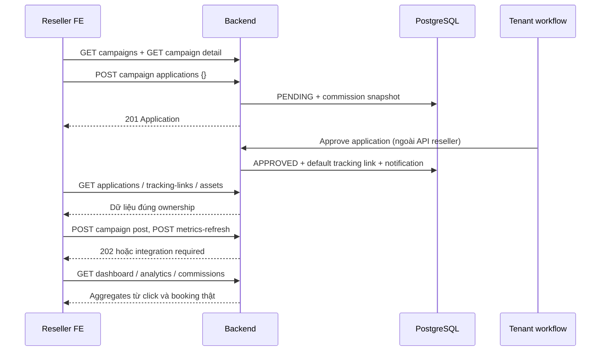

# Thiết kế API cho toàn bộ giao diện Reseller

Ngày rà soát: **05/11/2026**. Trạng thái: **thiết kế đề xuất, chưa triển khai endpoint nghiệp vụ**.

Tài liệu lấy giao diện Next.js trong `FE` làm nguồn chính, đối chiếu prototype `UI`, backend đang build trong `BE`, migration, cấu hình và các tài liệu database. Mã trong `archive/legacy-v1` chỉ là lịch sử, không phải API đang hoạt động. Không kết nối database thực tế và không suy ra rằng dữ liệu mẫu là dữ liệu nghiệp vụ đã được xác nhận.

## 1. Kết quả rà soát và phạm vi

### 1.1 Nguồn đối chiếu

| Nguồn trong repository | Nội dung dùng để thiết kế |
| --- | --- |
| `FE/app/reseller/[slug]/page.tsx`, `FE/app/reseller/dashboard/page.tsx` | Route, redirect, dashboard |
| `FE/components/wireframe-special-pages.tsx` | Marketplace, chi tiết, social posts, content/video, profile, notifications |
| `FE/components/wireframe-table-page.tsx` | Tìm kiếm, bộ lọc, thao tác trên bảng, analytics |
| `FE/lib/wireframe-mocks.ts`, `FE/lib/mock-data.ts` | Các cột, KPI và trường đang hiển thị |
| `FE/lib/reseller-campaign-membership.ts` | Request to join, Pending/Active, hành vi My campaigns |
| `FE/components/role-workspace.tsx`, `FE/lib/role-navigation.ts`, `FE/lib/mock-auth.ts` | Layout, chuông thông báo, account menu, logout, phiên demo |
| `FE/app/account`, `FE/app/login`, `FE/app/forgot-password`, `FE/app/signup` | Giao diện dùng chung có liên quan reseller |
| `UI/reseller`, `UI/shared-pages`, `UI/tenant`, `UI/storefront` | Prototype và liên hệ tenant → reseller → khách hàng |
| `BE/src/main/java/com/aitravel/reseller/controller` | Auth, account có feature flag, Platform Admin; chưa có reseller controller |
| `BE/src/main/java/com/aitravel/reseller/entity`, `repository` | Model nghiệp vụ hiện đã có entity/repository |
| `BE/src/main/resources/db/migration/V1…V16` | Schema thực thi, CHECK, FK, unique, snapshot và trigger |
| `BE/src/main/resources/application.yaml`, `BE/pom.xml`, `docker-compose.yml`, `FE/next.config.ts` | Flyway, môi trường, stack, điểm tích hợp |
| `docs/DATABASE_V2.md`, `docs/PROJECT_DATABASE_REVIEW.md`, `docs/PLATFORM_ADMIN_API.md` | Bối cảnh thay schema; nội dung cũ phải kiểm tra lại với code |

**Hiện trạng quan trọng:**

- FE dùng mock và state trong trình duyệt. Request join, lưu hồ sơ, đọc thông báo chưa persist backend. Đăng nhập demo chưa gọi AuthController.
- Ba API auth đang khai báo hoạt động: login, refresh, logout. Nhóm register/OTP/reset có code nhưng `app.features.account-management: false`.
- Flyway thực tế đọc `classpath:db/migration`, schema `travel_v2`, Hibernate `validate`. Không lấy `db/redesign` làm nguồn migration đang chạy.
- Tài liệu cũ nói chỉ có User/Role entity không còn đúng với cây source hiện tại. Tương tự, đổi cờ `actor-functions` không tự tạo các controller reseller còn thiếu.
- `/reseller/ai-content` đang redirect sang My campaigns; thư viện thực dùng `/reseller/campaign-content`. `/reseller/campaign-videos` là alias cùng component.
- Video hiện là **concept/brief**, chưa có file phát hoặc tải. “Save selected brief” mới đổi state.
- Social metrics hiện là số ước lượng sinh từ URL. Không thể dùng làm thống kê thật.
- Schema chưa có click event theo thời gian, thông báo, preference, saved brief. Đây là dependency phải giải quyết, không thể chỉ thêm controller.

### 1.2 Ma trận màn hình → thao tác → API

Quy ước `R = /api/v1/reseller`, `A = /api/v1/account`. Mọi đường dẫn rút gọn bên dưới đều là API backend, không phải route FE.

| Màn hình FE | Thành phần/thao tác | API đề xuất |
| --- | --- | --- |
| Layout tất cả trang | Tên, email, role, trạng thái, avatar chữ cái | `GET A/me` |
| Layout | Chuông, badge, 3 thông báo gần nhất | `GET A/notifications?size=3`, `GET A/notifications/unread-count` |
| Layout | Mark read / tự đánh dấu khi mở popover | `PATCH A/notifications/read` với IDs đã hiển thị |
| Layout | Đăng xuất | `POST /api/v1/auth/logout` hiện có |
| `/reseller/dashboard` | 4 KPI, pending/approved/paid, social views, biểu đồ, campaign, link và commission gần nhất | `GET R/dashboard` |
| `/reseller/campaign-marketplace` | Tìm kiếm, category, destination, 10%+, participation, card | `GET R/campaign-filters`, `GET R/campaigns` |
| Marketplace / campaign detail | Request to join / Apply | `POST R/campaigns/{campaignId}/applications` |
| `/reseller/campaign-detail?campaignId=…` | Gallery, mô tả, offer, terms, status | `GET R/campaigns/{campaignId}` |
| Campaign detail, Active | Các bài TikTok/Facebook đã lưu | `GET R/campaigns/{campaignId}/posts` |
| Campaign detail, Active | Show metrics lần đầu / sau sửa URL | `POST R/campaigns/{campaignId}/posts`, `PATCH R/posts/{postId}`, `POST R/posts/{postId}/metrics-refresh` |
| Campaign detail, Active | Kết quả đồng bộ / xóa link đã lưu | `GET R/posts/{postId}`, `DELETE R/posts/{postId}` |
| `/reseller/my-campaigns` | Search, status, joined, commission | `GET R/applications` |
| My campaigns/detail | View, Tracking link, Get content, View stats | Điều hướng bằng UUID, API của trang đích; không mutation |
| `/reseller/tracking-links` | Search, campaign, URL, clicks, conversions, created | `GET R/tracking-links` |
| Tracking links/dashboard | Copy link | Clipboard FE, không endpoint |
| `/reseller/commissions` | Search, status, 4 thẻ tổng tiền, bảng | `GET R/commissions`, `GET R/commissions/summary` |
| `/reseller/analytics` | Period, KPI, chart, search theo campaign | `GET R/analytics/summary`, `GET R/analytics/timeseries`, `GET R/analytics/campaigns` |
| `/reseller/campaign-content`, `/reseller/campaign-videos` | All/Content/Videos, product/type/language/search | `GET R/campaigns/{campaignId}/assets` |
| Content Library | Chọn video, đọc brief | `GET R/assets/{assetId}` hoặc dữ liệu list đã tải |
| Content Library | Copy content / Copy video brief | Clipboard FE |
| Content Library | Save selected brief | `PUT R/saved-assets/{assetId}` |
| Content Library | Phát/tải file thật nếu sau này có | `GET R/assets/{assetId}/download` — mở rộng, hiện UI chưa có file |
| `/reseller/profile-settings`, `/account/profile` | Full name, email, phone, website, about, 3 checkbox, Save | `GET A/me`, `PATCH A/me`; đổi email qua bước xác minh riêng |
| `/account/notifications` | All/Unread/Read, chi tiết, Mark read, Mark all | `GET A/notifications`, `GET A/notifications/{notificationId}`, `PATCH A/notifications/{notificationId}/read`, `PATCH A/notifications/read` |
| `/login`, `/forgot-password`, `/signup` | Truy cập tài khoản | Nhóm auth ở mục 4 |

Route FE hiện truyền **tên** qua `?campaign=`; thiết kế tích hợp đổi thành `?campaignId=<uuid>`. Không lookup tên làm khóa, không fallback sang campaign đầu tiên khi UUID sai. `from` chỉ nhận `my-campaigns` hoặc `campaign-marketplace`, không dùng làm URL redirect tùy ý.

## 2. Quy ước hợp đồng chung

### 2.1 Kiểu dữ liệu và response

- JSON camelCase, UTF-8. ID nghiệp vụ là UUID string. `{campaignId}`, `{assetId}`, `{postId}`, `{notificationId}` bắt buộc là UUID hợp lệ; sai định dạng → 400.
- `Instant` là ISO-8601 UTC, ví dụ `2026-11-05T03:00:00Z`; ngày chart `YYYY-MM-DD`. FE format ngôn ngữ/thời gian, không nhận ngày kiểu “14 Oct 2026” để tính toán.
- Money là `{ "amount": "684.20", "currency": "USD" }`, dùng decimal string; backend tính BigDecimal. Không mặc định USD từ ký hiệu `$` của mock; schema hiện mặc định VND cho booking/commission.
- Rate hoa hồng là decimal string `"12.00"`, nghĩa là 12%, không phải 0.12. `conversionRate` là số phần trăm, làm tròn 2 chữ số.
- Count JSON là integer không âm; nếu vượt miền integer an toàn của JS phải chuyển hợp đồng sang decimal string trước khi phát hành. Chưa có số liệu → `null`, khác `0` có quan sát.
- GET không có request body. POST/PATCH/PUT dùng `Content-Type: application/json` trừ khi nêu khác.
- Giữ envelope đang có của `ApiResponse<T>`; tất cả ví dụ DTO bên dưới là phần `data`.

```json
{
  "success": true,
  "message": "Success",
  "data": {
    "items": [],
    "page": 0,
    "size": 20,
    "totalElements": 0,
    "totalPages": 0
  }
}
```

Danh sách dùng `Page<T>` như trên. `page=0`, `size=20`, tối đa 100; page vượt cuối trả 200 với items rỗng. `q` trim, tối đa 200 ký tự, tìm case-insensitive; rỗng nghĩa là không lọc. Query enum/sort không hợp lệ trả 400. Sort chỉ nhận allowlist, luôn thêm `id` làm tie-breaker cùng chiều; không đưa tên field tùy ý vào SQL.

Lỗi đề xuất mở rộng bằng `data: ErrorDetail`, không phá ba trường envelope:

```json
{
  "success": false,
  "message": "Campaign is not accepting applications",
  "data": {
    "code": "CAMPAIGN_NOT_OPEN",
    "fieldErrors": [],
    "requestId": "req-opaque-id"
  }
}
```

`fieldErrors` là `[{"field":"websiteUrl","message":"Must use HTTPS"}]`. Đây là chuẩn lỗi mới cần áp dụng cho reseller/account; auth và exception handler hiện tại chưa đảm bảo cấu trúc này.

| HTTP | Ý nghĩa chung |
| --- | --- |
| 200 | Đọc/cập nhật thành công; PUT đã tồn tại; retry application đã tồn tại |
| 201 | Application hoặc post được tạo; `Location` trỏ API đọc tài nguyên tương ứng |
| 202 | Công việc metrics / xác minh email đã nhận |
| 204 | Xóa post thành công, không body |
| 400 | JSON, UUID, query, field validation sai |
| 401 | Không có phiên / token hết hạn |
| 403 | Sai role, reseller chưa active, hoặc action cần membership APPROVED |
| 404 | Tài nguyên không tồn tại hoặc không thuộc phạm vi được xem |
| 409 | Trạng thái xung đột, version cũ, idempotency key khác payload |
| 422 | URL social đúng cú pháp nhưng không phải loại post được hỗ trợ |
| 429 | Rate limit; có `Retry-After` |
| 503 | Dependency không sẵn sàng; không thay bằng dữ liệu demo |

### 2.2 Phân quyền và tenant scope

1. `R/**` yêu cầu JWT và `ROLE_RESELLER`; bổ sung matcher/method authorization vì SecurityConfig hiện chỉ giới hạn role riêng cho admin.
2. Từ principal resolve `users.id` → `reseller_profiles.user_id`; không nhận `resellerId` do client tự khai để quyết định ownership. Kiểm tra user ACTIVE và profile ACTIVE mỗi request nghiệp vụ (cache ngắn có invalidation nếu dùng).
3. Profile thiếu → 403 `RESELLER_PROFILE_REQUIRED`; profile PENDING/SUSPENDED/CLOSED → 403 `RESELLER_NOT_ACTIVE`. `/account/me` vẫn cho user ACTIVE xem trạng thái profile để hiển thị hướng dẫn.
4. Reseller có thể tham gia nhiều merchant. Scope đi qua `campaign → product → merchant`, và `application → reseller`; không mặc định một tenantId trên phiên reseller.
5. GET private theo ID phải kèm điều kiện owner trong query; không trả khách hàng, email khách, payout_info, token social, prompt AI nội bộ.
6. Asset/post/tracking action kiểm tra lại membership và campaign/merchant; FE ẩn nút không thay thế kiểm tra server.
7. Merchant SUSPENDED/CLOSED không nhận application hay promotion mới; lịch sử commission/analytics của chính reseller vẫn đọc được. Campaign lịch sử đã tham gia vẫn hiện trong My campaigns với trạng thái thật.
8. Các giá trị `actions` trong response là gợi ý render; không phải giấy phép dùng lại khi state đã đổi.

### 2.3 Thời gian và tổng hợp

Nhóm analytics/dashboard nhận `period=LAST_30_DAYS|LAST_7_DAYS|THIS_MONTH|CUSTOM` (mặc định LAST_30_DAYS), `timezone` IANA (mặc định `Asia/Ho_Chi_Minh`). CUSTOM bắt buộc `from`, `to` theo ngày địa phương, cả hai đầu gồm trong khoảng; tối đa 366 ngày. Với preset không gửi from/to. Backend chuyển thành `[startInclusive, endExclusive)` UTC; ngày hiện tại chỉ tính tới `asOf`. Không lấy ngày cố định trong mock.

Response có `range:{from,to,timezone,startInclusive,endExclusive}`, `asOf`, `dataStatus: COMPLETE|PARTIAL|UNAVAILABLE`, `availableFrom` nullable. Không đủ lịch sử thì đánh dấu partial, không phân bổ click_count tùy ý vào các ngày cũ.

- `clicks`: sự kiện truy cập referral hợp lệ đã deduplicate theo quy tắc mục 9; không tính Copy link.
- `conversions`: số booking phân biệt được attribution tới link, tạo trong khoảng, hiện ở CONFIRMED hoặc COMPLETED. Hủy/refund loại khỏi báo cáo hiện hành; dữ liệu quá khứ có thể được điều chỉnh, thể hiện bằng asOf.
- `conversionRate = conversions / clicks * 100`; clicks=0 → 0 kèm `rateAvailable=false`. Đây là tỷ số hoạt động theo kỳ, không phải funnel cohort; có thể >100% do chuyển đổi từ click kỳ trước.
- Chart, summary, bảng dùng cùng filter và định nghĩa. Nếu q/campaignId lọc analytics thì áp dụng cho cả ba API. Summary tính toàn bộ kết quả trước pagination.
- Social views là snapshot lifetime của post, không phải clicks và không suy ra tăng trưởng theo ngày nếu thiếu lịch sử social.
- Tổng tiền **tách theo currency**; không cộng VND với USD và không tự quy đổi.

## 3. Danh mục endpoint nghiệp vụ

Tất cả endpoint trong bảng này là **đề xuất mới**. Các contract chi tiết ở mục 5–12. Prefix `R`, `A` như mục 1.

| ID | Method | Endpoint | Response data | Thành công |
| --- | --- | --- | --- | --- |
| R01 | GET | `R/dashboard` | Dashboard | 200 |
| R02 | GET | `R/campaign-filters` | CampaignFilters | 200 |
| R03 | GET | `R/campaigns` | Page<CampaignCard> | 200 |
| R04 | GET | `R/campaigns/{campaignId}` | CampaignDetail | 200 |
| R05 | POST | `R/campaigns/{campaignId}/applications` | Application | 201/200 |
| R06 | GET | `R/applications` | Page<Application> | 200 |
| R07 | GET | `R/campaigns/{campaignId}/posts` | Page<SocialPost> | 200 |
| R08 | POST | `R/campaigns/{campaignId}/posts` | SocialPost | 201/200 |
| R09 | GET | `R/posts/{postId}` | SocialPost | 200 |
| R10 | PATCH | `R/posts/{postId}` | SocialPost | 200 |
| R11 | DELETE | `R/posts/{postId}` | Không body | 204 |
| R12 | POST | `R/posts/{postId}/metrics-refresh` | MetricsRefresh | 202 |
| R13 | GET | `R/tracking-links` | Page<TrackingLink> | 200 |
| R14 | GET | `R/commissions` | Page<Commission> | 200 |
| R15 | GET | `R/commissions/summary` | CommissionSummary | 200 |
| R16 | GET | `R/analytics/summary` | AnalyticsSummary | 200 |
| R17 | GET | `R/analytics/timeseries` | AnalyticsSeries | 200 |
| R18 | GET | `R/analytics/campaigns` | Page<CampaignPerformance> + range/asOf | 200 |
| R19 | GET | `R/campaigns/{campaignId}/assets` | Page<Asset> + facets | 200 |
| R20 | GET | `R/assets/{assetId}` | Asset | 200 |
| R21 | PUT | `R/saved-assets/{assetId}` | SavedAsset | 200 |
| R22 | GET | `R/assets/{assetId}/download` | DownloadGrant; mở rộng | 200 |
| A01 | GET | `A/me` | Account | 200 |
| A02 | PATCH | `A/me` | Account | 200 |
| A03 | POST | `A/email-change-requests` | EmailChangeChallenge | 202 |
| A04 | POST | `A/email-change-requests/{requestId}/verify` | `{email,verifiedAt}` | 200 |
| A05 | GET | `A/notifications` | Page<NotificationSummary> + snapshotAt | 200 |
| A06 | GET | `A/notifications/unread-count` | `{unreadCount,asOf}` | 200 |
| A07 | GET | `A/notifications/{notificationId}` | NotificationDetail | 200 |
| A08 | PATCH | `A/notifications/{notificationId}/read` | `{id,readAt,unreadCount}` | 200 |
| A09 | PATCH | `A/notifications/read` | `{updatedCount,unreadCount,asOf}` | 200 |

Không thiết kế API CRUD campaign/product, duyệt application, duyệt commission, trả tiền hoặc tạo AI cho reseller: các thao tác đó thuộc tenant/admin, không xuất hiện trong UI reseller. Không thêm API rút tiền chỉ vì schema có payouts.

## 4. Đăng nhập, phiên và khôi phục tài khoản

| Method/path đầy đủ | Request JSON | Response data hiện tại | Trạng thái |
| --- | --- | --- | --- |
| `POST /api/v1/auth/login` | `{email,password}` | `{accessToken,refreshToken,tokenType}` | Có controller, 200 |
| `POST /api/v1/auth/refresh` | `{refreshToken}` | Cùng AuthResponse; refresh token được rotate | Có controller, 200 |
| `POST /api/v1/auth/logout` | `{refreshToken}` | null | Có controller, 200 |
| `POST /api/v1/auth/register` | `{email,password,fullName}` | null | Có code nhưng flag tắt |
| `POST /api/v1/auth/verify-email` | `{email,otp}` | null | Flag tắt |
| `POST /api/v1/auth/resend-verification` | `{email}` | null | Flag tắt |
| `POST /api/v1/auth/forgot-password` | `{email}` | null; thông điệp không tiết lộ tài khoản | Flag tắt |
| `POST /api/v1/auth/verify-reset-otp` | `{email,otp}` | resetToken string | Flag tắt |
| `POST /api/v1/auth/reset-password` | `{resetToken,newPassword}` | null | Flag tắt |

Sau login gọi A01 để lấy role/name/profile; AuthResponse hiện chưa có thông tin này. FE thực hiện refresh single-flight khi 401, retry request một lần; thất bại thì về login. Logout hiện thu hồi refresh session, không mặc định thu hồi access JWT ngay. Không lưu password trong demo session khi tích hợp thật.

`/signup` còn là form mẫu, có nút GitHub chưa nối OAuth; không coi GitHub signup là tính năng đã có. Register DTO hiện password tối thiểu 6, fullName tối đa 100; UI ghi password tối thiểu 8. Đề xuất thống nhất password >=8 trước khi bật account-management. Cần bổ sung bước OTP/reset UI và tạo `reseller_profiles` khi cấp tài khoản reseller; register hiện chỉ xử lý user/role. Kiểm tra role scope trước khi bật: code register tạo ROLE_RESELLER scope PLATFORM trong khi `user_roles` migration yêu cầu GLOBAL. Không đơn thuần bật flag trên schema hiện tại.

SecurityConfig hiện permit `/api/v1/auth/**`, kể cả logout; mô tả Swagger có Bearer không đồng nghĩa runtime đang bắt Bearer. Khi tích hợp nên yêu cầu phiên hợp lệ và xác nhận refresh token thuộc phiên/user cho logout. Tách lỗi sai credentials 401, locked/disabled 403, rate-limit 429 theo auth contract triển khai; không tuyên bố mã lỗi đề xuất đã được backend hỗ trợ đầy đủ.

## 5. Marketplace, chi tiết và tham gia campaign

### R02 — GET campaign-filters

Không query/body. Trả `categories:[{code,label}]`, `destinations:[{code,label,countryCode}]`, `participationStatuses`, `commissionTypes`. Chỉ lấy từ tập campaign public có thể xem; không hardcode ba điểm đến mẫu. Category đề xuất TOURS_CRUISES/HOTELS/PACKAGES; destination code ổn định, label do FE hiển thị.

### R03 — GET campaigns

Query: `q`, `category`, `destination`, `commissionType=PERCENTAGE|FIXED_AMOUNT`, `minCommissionPercent` (decimal 0–100), `participationStatus=NOT_JOINED|PENDING|APPROVED|REJECTED|WITHDRAWN|SUSPENDED`, `page`, `size`, `sort=createdAt,desc|title,asc|endAt,asc` (mặc định createdAt,desc).

`10%+` ánh xạ `commissionType=PERCENTAGE&minCommissionPercent=10`; fixed `$38/booking` không được qua bộ lọc 10% chỉ vì parseFloat=38. Không gửi minCommissionPercent cùng FIXED_AMOUNT (400).

Public marketplace: merchant ACTIVE, product AVAILABLE, campaign ACTIVE, chưa hết hạn. Cho xem campaign có ngày bắt đầu tương lai để đăng ký sớm; chỉ ghi nhận referral từ startAt. Tham gia của chính user là LEFT JOIN để không lộ application người khác. UI có thể hiển thị campaign từng tham gia qua My campaigns nếu đã paused/ended.

CampaignCard:

```json
{
  "id": "11111111-1111-4111-8111-111111111111",
  "title": "Ha Long Bay Weekend Escape",
  "merchant": {"id":"22222222-2222-4222-8222-222222222222","name":"Lantern Tide"},
  "product": {"id":"33333333-3333-4333-8333-333333333333","title":"Ha Long Bay cruise","category":"TOURS_CRUISES","destination":{"code":"HA_LONG","label":"Ha Long Bay","countryCode":"VN"}},
  "coverImage": {"url":"https://cdn.example/halong.jpg","alt":"Ha Long Bay","caption":"Campaign cover"},
  "commission": {"type":"PERCENTAGE","rate":"12.00","currency":null},
  "startAt":"2026-10-01T00:00:00Z",
  "endAt":"2026-12-31T16:59:59Z",
  "campaignStatus":"ACTIVE",
  "participation": {"applicationId":null,"status":"NOT_JOINED","appliedAt":null,"approvedAt":null,"commissionSnapshot":null},
  "actions": {"canApply":true,"canManagePosts":false,"canUseAssets":false,"canUseTrackingLink":false,"reasonCode":null}
}
```

Mọi field trên có mặt; nullable là image, startAt/endAt và dữ liệu participation chưa có. Commission FIXED_AMOUNT bắt buộc currency; PERCENTAGE currency null. Có membership thì hiển thị `commissionSnapshot` thay cho rate mới, có thể bổ sung nhãn “current offer” nếu cần so sánh.

### R04 — GET campaigns/{campaignId}

200: CampaignCard cộng `subtitle:string|null`, `description:string|null`, `expectations:string|null`, `gallery:[{url,alt,caption,sortOrder}]`, `terms:{text,version,commissionEligibility,cookieWindowDays}`, `product.price:Money`, `product.travelDetails:string|null`.

Gallery next/previous là state FE, không gọi API theo ảnh. Campaign period không được tự gán thành travel dates; schema hiện chỉ có start/end campaign, cần travelDetails riêng nếu muốn hiển thị ngày đi. 404 nếu không public và chưa từng tham gia; campaign paused/ended đã tham gia trả 200 với actions=false, dữ liệu lịch sử giữ nguyên.

### R05 — POST campaigns/{campaignId}/applications

Body `{}`; không nhận rate/status/resellerId. Header `Idempotency-Key` UUID đề xuất bắt buộc, lưu theo user + method + path + payload hash trong 24h. Cùng key khác payload → 409 `IDEMPOTENCY_CONFLICT`.

- Profile ACTIVE, campaign đủ điều kiện public mới nhận apply.
- Insert status PENDING; trigger V15 copy commission type/rate tại **lúc đăng ký**, không phải lúc duyệt. Sau đó snapshot bất biến.
- Mới tạo → 201 Application. Retry khi đã PENDING/APPROVED → 200 Application hiện có, không gửi thông báo lặp. REJECTED/WITHDRAWN/SUSPENDED → 409 `APPLICATION_NOT_REAPPLICABLE`; mở lại đơn là quy trình khác chưa có trong UI.
- Unique `(campaign_id,reseller_id)` là chốt race-condition; bắt conflict rồi đọc bản ghi hiện có. Không chỉ disable nút trên FE.
- Campaign đóng giữa lúc xem và gửi → 409 `CAMPAIGN_NOT_OPEN`. Kiểm tra và insert trong transaction với khóa/kiểm soát thay đổi campaign.

Application: `{id,campaign:CampaignCard, status,appliedAt,reviewedAt,approvedAt,commissionSnapshot:{type,rate,currency},actions}`. `approvedAt=reviewedAt` chỉ khi APPROVED; không dùng reviewedAt của đơn REJECTED làm joined date. Response campaign.participation phản ánh cùng application.

### R06 — GET applications

Query `q` (campaign/product), `status` theo enum DB, `page,size,sort=appliedAt,desc|reviewedAt,desc|title,asc`; mặc định appliedAt,desc. Chỉ application của reseller đang gọi. Không lọc mất bản ghi chỉ vì campaign ended hay merchant suspended.

| DB/application status | UI | Hành động |
| --- | --- | --- |
| Không có | Not joined | View, Apply nếu canApply |
| PENDING | Pending approval | View, hiển thị appliedAt |
| APPROVED và campaign đang cho quảng bá | Active | View, tracking, content, posts, stats |
| APPROVED nhưng campaign paused/ended | Approved + badge campaign riêng | View/history, khóa promotion mới |
| REJECTED / WITHDRAWN / SUSPENDED | Nhãn tương ứng | View, lý do nếu có; không tự đổi thành Not joined |

“Active” trong UI không phải giá trị hợp lệ của `campaign_applications.status`. FE phải map rõ ràng và mở rộng filter cho trạng thái thật. Tenant approval phải tạo tracking link mặc định trong cùng transaction hoặc outbox có retry; reseller không tự duyệt đơn.

## 6. Social post performance trong campaign detail

R07 query `platform=TIKTOK|FACEBOOK`, `page,size`, sort cố định `createdAt,asc`; 200 Page<SocialPost>. Chỉ đọc bài của reseller trong campaign; mặc định loại REMOVED. R09 trả cùng DTO theo post ID.

SocialPost:

```json
{
  "id":"44444444-4444-4444-8444-444444444444",
  "campaignId":"11111111-1111-4111-8111-111111111111",
  "platform":"TIKTOK",
  "postUrl":"https://www.tiktok.com/@partner/video/7350000000000000001",
  "socialAccountId":null,
  "status":"PUBLISHED",
  "version":1,
  "metrics":{"views":null,"likes":null,"comments":null,"shares":null,"source":"UNAVAILABLE","fetchedAt":null},
  "sync":{"status":"NOT_REQUESTED","lastRequestedAt":null,"errorCode":null},
  "createdAt":"2026-11-05T03:00:00Z"
}
```

`metrics.source=API|MANUAL|UNAVAILABLE`; `sync.status=NOT_REQUESTED|QUEUED|RUNNING|SUCCEEDED|FAILED|UNAVAILABLE`. Nullable metrics nghĩa là chưa có quyền/chưa thu thập, không trả số 0 mặc định từ DB như dữ liệu đã xác minh. Khi refresh thất bại giữ last-good metrics/fetchedAt và sync lỗi.

### R08 — POST campaigns/{campaignId}/posts

Body `{platform,postUrl,socialAccountId?}`; platform và postUrl bắt buộc. URL tối đa 2048 ký tự, HTTPS, host thuộc allowlist TikTok/Facebook/fb.watch và path phải là post/video được hỗ trợ. Không nhận views/likes/resellerId từ client. Có socialAccountId thì phải thuộc reseller và cùng platform; không xác định ownership tài khoản chỉ bằng URL.

201 SocialPost; cùng canonical platform post trong cùng application → 200 bản ghi hiện có. Unique `(campaign_application_id,platform,canonical_post_key)` chống lặp; canonical_post_key do server chuẩn hóa hoặc connector resolve. Tối đa đề xuất 100 bài đang sử dụng/campaign/reseller, vượt → 409 `POST_LIMIT_REACHED`. Profile/membership/campaign phải đủ điều kiện quảng bá.

UI hiện chỉ nhập URL, nhưng DB yêu cầu social_account_id NOT NULL. **Thiết kế chọn cho phép liên kết bài chưa có social account**, thêm platform vào post, cho social_account_id nullable; metrics UNAVAILABLE tới khi có integration được cấp quyền. Không tự tạo “tài khoản đã kết nối” giả để thỏa FK.

### R10 — PATCH posts/{postId}

Body `{postUrl,version}` bắt buộc; platform không đổi tại endpoint này. Version stale → 409 `VERSION_CONFLICT`. URL mới kiểm tra như R08, reset metrics/sync, tăng version; không để job cũ cập nhật metrics URL mới (job mang post version). Trùng canonical post đang có → 409 `POST_ALREADY_EXISTS`.

### R11 — DELETE posts/{postId}

Không body. Soft-delete status REMOVED; 204 kể cả đã removed và vẫn thuộc owner. ID người khác → 404. Cho owner xóa cả khi campaign đã ended; đây là dọn thông tin cá nhân, không tạo promotion. Không trừ sửa sổ commission/referral. Dashboard social tổng hợp lại tập bài còn hiển thị, có nhãn snapshot.

### R12 — POST posts/{postId}/metrics-refresh

Body `{}`. 202 `{postId,status:"QUEUED",pollAfterSeconds:3,statusUrl:"/api/v1/reseller/posts/<uuid>"}`. Nếu job đang queued/running thì trả cùng trạng thái, không tạo job mới. Cooldown đề xuất 60 giây/post và 30 request/phút/user; vượt → 429. FE poll R09 theo pollAfterSeconds, dừng khi terminal hoặc rời trang; sau 60 giây hiển thị đang xử lý và cho tải lại.

Chưa có connector/quyền → 409 `SOCIAL_INTEGRATION_REQUIRED`, UI giải thích metrics chưa khả dụng; không sinh estimates. Job worker chỉ dùng connector được cấp quyền, không fetch tùy ý URL do user nhập. Nếu phải resolve redirect, kiểm tra HTTPS/host/IP ở mỗi bước để tránh truy cập mạng nội bộ. Chi tiết OAuth/provider là dependency triển khai riêng, tài liệu này không cam kết provider lấy được metrics cho mọi public URL.

**Mapping nút:** Add another link tạo hàng trống local; Show metrics lưu R08 hoặc R10 rồi R12; Remove hàng chưa lưu chỉ xóa local, hàng có ID gọi R11. Use sample link chỉ dành demo, không gửi mẫu lên dữ liệu thật. Badge “N links” production đếm post persisted, không đếm ô chưa hợp lệ.

## 7. Content Library và video brief

### R19 — GET campaigns/{campaignId}/assets

Query `kind=ALL|CONTENT|VIDEO` (ALL), `productId`, `contentType=SOCIAL_CAPTION|PROMOTIONAL_DESCRIPTION|HASHTAGS|VIDEO_CONCEPT|VIDEO`, `language=en|vi`, `q`, `page,size`, `sort=publishedAt,desc|title,asc` (publishedAt,desc).

Campaign hiện gắn một product; productId nếu gửi phải khớp, sai → 400 `PRODUCT_CAMPAIGN_MISMATCH`. `facets:{products:[{id,title}],contentTypes:[],languages:[],counts:{content,videos}}` lấy từ toàn bộ tập asset được quyền xem của campaign trước filter, không chỉ trang hiện tại. Chuyển tab chỉ đổi kind; không phát sinh mutation.

Chỉ membership APPROVED có quyền dùng assets; campaign PAUSED/ENDED hoặc merchant không ACTIVE trả 403 `CAMPAIGN_ASSETS_UNAVAILABLE` cho promotion mới. Chỉ asset đã duyệt/published; `generation_status=COMPLETED` không có nghĩa tenant đã duyệt. Với dữ liệu cũ cần backfill publication state rõ ràng trước khi expose.

Asset: `{id,campaignId,productId,title,kind,contentType,language,tone,text,brief,thumbnailUrl,durationSeconds,aspectRatio,mediaStatus,publishedAt,version,saved,capabilities}`.

- `kind=CONTENT|VIDEO`; `contentType` là enum UI nêu trên.
- text là plain text cho content; brief cho concept/video, cả hai nullable theo loại. Không trả prompt_used hoặc toàn bộ generated_content nội bộ.
- durationSeconds integer >=0 nullable; aspectRatio `9:16|16:9|1:1|null`; thumbnailUrl nullable.
- `mediaStatus=CONCEPT_ONLY|READY|UNAVAILABLE`; capabilities `{canCopy,canSave,canPlay,canDownload}`. CONCEPT_ONLY bắt buộc canPlay/canDownload=false.
- `saved` boolean theo user hiện tại; danh sách trả text/brief đủ cho Copy và preview. Các field không áp dụng trả null.
- Mapping DB: CAPTION → SOCIAL_CAPTION; SOCIAL_POST + subtype PROMOTIONAL_DESCRIPTION → PROMOTIONAL_DESCRIPTION; OTHER + subtype HASHTAGS → HASHTAGS; VIDEO_SCRIPT → VIDEO_CONCEPT; VIDEO → VIDEO. Cần subtype/language/tone explicit, không đoán từ text.

### R20 — GET assets/{assetId}

200 Asset đầy đủ; kiểm tra publication/membership tương tự list; asset bị thu hồi hoặc campaign không thuộc quyền xem → 404. Việc chọn một concept có sẵn trong list không bắt buộc gọi lại.

### R21 — PUT saved-assets/{assetId}

Body `{assetVersion:1}` bắt buộc. 200 `{assetId,assetVersion,savedAt,briefSnapshot}`. Upsert unique `(reseller_id,asset_id)`; cùng version là idempotent, không đổi savedAt khi retry. Version đã thay đổi → 409 `ASSET_VERSION_CHANGED`, FE tải lại trước khi lưu. Chỉ concept/video có brief mới lưu; content không có brief → 400 `ASSET_NOT_A_BRIEF`.

Đây là ý nghĩa persist được đề xuất cho nút “Save selected brief”; không tạo video và không công bố nội dung. Lưu snapshot brief + version để không âm thầm thay nội dung đã lưu khi tenant sửa. R19/R20 trả saved=true nếu bản hiện tại đã lưu. Không thêm màn hình Saved Library ngoài phạm vi UI hiện tại.

### R22 — GET assets/{assetId}/download (mở rộng)

200 `{url,expiresAt,fileName,mimeType,sizeBytes}`; signed URL thời hạn đề xuất 5 phút, chỉ file đã published/READY, kiểm tra lại quyền trước cấp. `mediaStatus=CONCEPT_ONLY` → 409 `ASSET_FILE_NOT_READY`. Không trả đường dẫn storage nội bộ. Đây là bổ sung khi có file thật; không cần giả lập download cho brief hiện tại. Phát video dùng grant có disposition inline, tải dùng query `disposition=attachment|inline` (attachment mặc định).

## 8. Tracking links và attribution

### R13 — GET tracking-links

Query `q` (campaign/URL), `campaignId`, `status=ACTIVE|INACTIVE`, `page,size`, `sort=createdAt,desc|clicks,desc` (createdAt,desc). Counters tại trang này là lifetime vì UI không có period. Response item:

```json
{
  "id":"55555555-5555-4555-8555-555555555555",
  "campaign":{"id":"11111111-1111-4111-8111-111111111111","title":"Ha Long Bay Weekend Escape"},
  "applicationId":"66666666-6666-4666-8666-666666666666",
  "trackingUrl":"https://go.example/r/random-code",
  "status":"ACTIVE",
  "effectiveStatus":"ACTIVE",
  "clicks":2840,
  "conversions":74,
  "conversionRate":2.61,
  "createdAt":"2026-10-10T03:00:00Z",
  "asOf":"2026-11-05T03:00:00Z"
}
```

effectiveStatus `ACTIVE|INACTIVE|CAMPAIGN_NOT_STARTED|CAMPAIGN_PAUSED|CAMPAIGN_ENDED|MEMBERSHIP_SUSPENDED|MERCHANT_UNAVAILABLE`; chỉ ACTIVE được quảng bá. Chỉ link thuộc application APPROVED mới được tạo; không tạo link cho Pending như dữ liệu mẫu hiện có. Lịch sử link vẫn đọc được khi không còn hoạt động.

UI chưa có Create/Edit/Delete link nên API list là đủ. Quy tắc đề xuất: mỗi application có đúng một default link được tenant approval tạo tự động, unique campaign_application_id; nếu tương lai có link theo kênh thì mở rộng bằng purpose/channel và unique có điều kiện. Copy link không gọi POST và không tăng click_count. URL tuyệt đối được backend dựng từ cấu hình domain tin cậy.

### Dependency công khai: GET /r/{trackingCode}

Đây là endpoint hạ tầng cho link đã copy, **không yêu cầu JWT reseller** và cần permit trong SecurityConfig. Không phải API màn hình và không được tính là endpoint đã có.

1. Lookup opaque code, đối chiếu link/application/campaign/product/merchant và thời gian. Code lạ → 404; không hoạt động → 410 với trang thông báo, không ghi attribution.
2. Ghi click event server-side và tạo opaque attribution token, expiry theo campaign.cookie_window_days; 302 Location tới storefront/checkout đã cấu hình allowlist. Không nhận target URL tùy ý trên request.
3. Cookie theo origin với Secure/HttpOnly/SameSite phù hợp; trường hợp checkout khác domain cần signed token trao đổi server-side. Không kỳ vọng cookie tự đi qua các domain độc lập.
4. Đề xuất last eligible click cho cùng merchant/product trong cookie window; booking lưu tracking_link_id bất biến sau xác nhận attribution. Client không tự khai reseller nhận hoa hồng.
5. Checkout/webhook tin cậy tạo/cập nhật booking với merchant/product/amount/currency đã xác minh, deduplicate bằng external booking ID. Các trang storefront hiện mock nên đây là dependency phải triển khai cùng, không phải việc đã hoạt động.

## 9. Analytics và dashboard

### R16 — GET analytics/summary

Query bộ thời gian mục 2.3 + `campaignId?`, `q?` (campaign title). 200 `{range,asOf,dataStatus,availableFrom,clicks,conversions,conversionRate,rateAvailable,previousPeriod:{clicks,conversions},changes:{clicksPercent,conversionsPercent}}`.

So sánh khoảng ngay trước có cùng số ngày địa phương, THIS_MONTH là month-to-date so với số ngày liền trước tương ứng. Denominator kỳ trước=0 → change null (FE “Chưa có cơ sở so sánh”), không Infinity. Cùng asOf logic cho summary/chart/table.

### R17 — GET analytics/timeseries

Cùng query R16 + `interval=DAY|WEEK` (DAY). 200 `{range,asOf,dataStatus,availableFrom,items:[{date,clicks,conversions,conversionRate,rateAvailable}]}`; WEEK bắt đầu thứ Hai, bucket đầu/cuối chỉ lấy phần nằm trong range. Ngày không phát sinh trong giai đoạn có tracking → 0; ngày trước availableFrom → null, không giả tạo 0. Trả actual counts, FE tính chiều cao chart; không dùng các mảng phần trăm hardcode hiện tại.

### R18 — GET analytics/campaigns

Cùng query R16 + `page,size,sort=clicks,desc|conversions,desc|title,asc` (clicks,desc). 200 Page<CampaignPerformance> cộng range/asOf/dataStatus/availableFrom; item `{campaignId,title,campaignStatus,clicks,conversions,conversionRate,rateAvailable}`. Tổng KPI không chỉ là sum trang đang hiển thị. Campaign đã tham gia nhưng không có hoạt động trong kỳ vẫn có row zero nếu dữ liệu đủ.

### R01 — GET dashboard

Query bộ thời gian (mặc định last 30 days); không q/campaignId. Endpoint tổng hợp một payload để tránh nhiều request và số liệu không đồng bộ:

```text
Dashboard {
  range, asOf, dataStatus, availableFrom,
  performance: {clicks, conversions, conversionRate, rateAvailable,
                changes: {clicksPercent, conversionsPercent}},
  earnings: CommissionSummary,                  // lifetime, ghi rõ scope
  socialViews: [{platform, views, source, fetchedAt, scope:"LIFETIME",
                 trackedPostCount, measuredPostCount}],
  timeseries: [{date, clicks, conversions}],    // cùng range performance
  joinedCampaigns: [{campaignId,title,campaignStatus,participationStatus}],
  recentTrackingLinks: TrackingLink[],         // lifetime counters
  recentCommissions: Commission[]              // gần nhất, mọi trạng thái
}
```

joinedCampaigns lấy tối đa 5 application APPROVED, reviewedAt desc; recentTrackingLinks/recentCommissions tối đa 5, createdAt desc. SocialViews có hai phần tử TIKTOK/FACEBOOK, sum theo canonical post duy nhất của reseller (tránh cùng bài gắn nhiều campaign bị cộng nhiều lần), số liệu snapshot mới nhất. Không có đo lường → views null; đo được một phần → source PARTIAL, FE ghi độ bao phủ. Source tổng hợp `API|MANUAL|MIXED|PARTIAL|UNAVAILABLE`; không dùng followers_count hoặc average_views thay total post views.

### Nguồn dữ liệu thống kê bắt buộc

`tracking_links.click_count` hiện chỉ là tổng, không thể tạo biểu đồ last 30 days. Đề xuất thêm `tracking_click_events(id,tracking_link_id,occurred_at,dedupe_key,is_valid)` và aggregate ngày. Quy tắc v1: chỉ GET redirect hợp lệ, loại bot đã nhận diện, dedupe cùng link + anonymous session trong cửa sổ 30 phút; không gọi đây là unique persons. Dedupe key không chứa raw IP/email, unique key bảo vệ retry. Các counter lifetime và daily cùng xuất phát từ valid event; transaction/outbox bảo đảm không cộng hai lần.

Booking conversions truy từ booking → tracking_link → application → campaign và lọc reseller, không join social_posts gây nhân số lượng. Booking tạo trước availableFrom vẫn có thể có conversion nếu dữ liệu booking có thật; dataStatus/rateAvailable phản ánh thiếu click history. Không suy ra lịch sử click từ conversion.

## 10. Commissions

### R14 — GET commissions

Query `q` (campaign, booking reference, product), `campaignId?`, `status?` theo enum DB, `currency?` (3 chữ in hoa), `from?`, `to?`, `timezone?`, `page,size`, `sort=createdAt,desc|amount,desc` (createdAt,desc). Không ngày = lifetime; nếu có phải có cả from/to, tối đa 366 ngày, lọc commission.created_at. Sort amount chỉ cho phép khi chọn currency để tránh so sánh sai loại tiền.

Item `{id,campaign:{id,title},product:{id,title},booking:{id,reference,status},amount:Money,status,createdAt,updatedAt,commissionSnapshot:{type,rate,currency}}`. Reference cần thêm dữ liệu nguồn booking; chưa có reference thì dùng UUID, không bịa `ORD-20418`. Không expose toàn bộ Booking entity hay PII khách.

### R15 — GET commissions/summary

Query như R14 trừ page/size/sort; **không nhận status**, để 4 thẻ luôn thể hiện cơ cấu của tập search/campaign/date/currency đã chọn. FE status filter chỉ đổi bảng và phải ghi rõ summary không bị lọc status.

```json
{
  "scope":"LIFETIME",
  "asOf":"2026-11-05T03:00:00Z",
  "byCurrency":[{
    "currency":"USD",
    "total":"4218.60",
    "pending":{"amount":"684.20","count":7},
    "approved":{"amount":"1122.40","count":10},
    "paid":{"amount":"2412.00","count":20},
    "payableAmount":"800.00",
    "cancelledAmount":"0.00",
    "reversedAmount":"0.00"
  }]
}
```

Các tổng là mô hình đề xuất, không phải dữ liệu thật. `scope=FILTERED` nếu có bất kỳ search/campaign/date/currency; thêm range nếu có ngày. Không có commission → byCurrency=[]; FE hiển thị “Chưa có hoa hồng”, không chọn USD ngầm.

| Raw status DB | Nhóm thẻ UI | Quy tắc |
| --- | --- | --- |
| PENDING | Pending | Chưa đủ điều kiện duyệt |
| APPROVED | Approved | Đã duyệt nhưng chưa chắc sẵn sàng payout |
| PAYABLE | Approved | Đã đủ điều kiện payout; cộng vào payableAmount |
| PAID | Paid | Payout hoàn tất, không chỉ tạo payout PROCESSING |
| PARTIALLY_PAID | Cần tách đã trả/còn lại | Chưa hỗ trợ trong MVP này; xem giới hạn bên dưới |
| CANCELLED | Ngoài total | Đơn hủy trước khi trả |
| REVERSED | Ngoài total, riêng reversedAmount | Hoa hồng bị đảo; cần ledger nếu đã có tiền chi |

MVP total=pending+approved+paid, không gọi đây là tiền có thể rút. UI “Approved — Ready for payout” hiện sai với enum DB; sửa thành “Đã duyệt”, dùng payableAmount khi cần sẵn sàng thanh toán. Filter bảng cần hiển thị đủ raw status; nếu giữ 3 nhóm thì dùng query riêng `statusGroup` ở phiên bản sau, không gửi APPROVED với nghĩa ngầm gồm PAYABLE.

Payout_items hiện unique commission_id và trigger gán toàn bộ commission amount; chưa mô hình hóa nhiều lần trả từng phần. MVP không tạo PARTIALLY_PAID. Nếu phát hiện dữ liệu trạng thái này, summary trả 409 `COMMISSION_LEDGER_REQUIRED` thay vì tự phân bổ tiền sai; list vẫn đọc raw status. Trước khi hỗ trợ partial/reversal sau chi phải bổ sung ledger, paid_amount/outstanding và quy tắc thu hồi; đây là giới hạn thiết kế chứ không che trạng thái DB.

Điều khoản UI đang có cả “confirmed” và “completed”. Đề xuất: booking CONFIRMED tạo PENDING commission; chỉ COMPLETED, qua tenant review/điều kiện đối soát mới APPROVED rồi PAYABLE. Tiền PERCENTAGE = eligible booking amount × rate_snapshot / 100, làm tròn theo đơn vị nhỏ nhất currency; FIXED_AMOUNT dùng rate_snapshot và currency_snapshot. Cần lưu eligible_amount, policy/version tại phát sinh; không tính lại bằng campaign.commission_rate sau này. Hủy/refund chạy bởi luồng tenant/booking, reseller chỉ đọc.

## 11. Hồ sơ và preferences

### A01 — GET account/me

JWT user ACTIVE; dùng chung account các role, trả phần reseller nếu có. Account:

```json
{
  "id":"77777777-7777-4777-8777-777777777777",
  "fullName":"Jordan Lee",
  "email":"jordan@example.test",
  "phone":"+84905550182",
  "roles":["ROLE_RESELLER"],
  "status":"ACTIVE",
  "reseller":{"id":"88888888-8888-4888-8888-888888888888","status":"ACTIVE"},
  "websiteUrl":"https://instagram.com/jordantravels",
  "bio":"Travel stories and local discoveries.",
  "preferences":{"campaignUpdates":true,"commissionSummaries":true,"productAnnouncements":false},
  "version":1
}
```

phone/websiteUrl/bio/reseller có thể null. Preferences luôn đầy đủ ba boolean. Avatar hiện là chữ cái từ fullName; không cần upload API khi UI chưa có upload.

### A02 — PATCH account/me

Body partial `{fullName?,phone?,websiteUrl?,bio?,preferences?,version}`; version bắt buộc. PATCH thiếu field giữ nguyên, null xóa nullable field; không cho fullName null. fullName trim 1–255 ký tự; phone <=50; websiteUrl HTTPS <=2048; bio <=2000; preferences chỉ ba boolean đã biết, merge field-level. Không nhận roles/status/resellerId/payoutInfo. Empty patch → 400. Version stale → 409. 200 Account mới, update user và profile/preference trong một transaction; FE cập nhật cả account menu.

Hai trang profile dùng cùng endpoint/cache để không lệch. Email trên UI được xử lý riêng: nếu email không đổi, Save gọi A02; nếu đổi, Save lưu profile bằng A02 rồi tạo A03 và hiển thị trạng thái cần OTP. Không báo “đã đổi email” khi mới gửi challenge. A02 từ chối field email bằng 400 `EMAIL_VERIFICATION_REQUIRED`.

### A03 — POST account/email-change-requests

Body `{newEmail,currentPassword}` bắt buộc; email đúng dạng <=255, normalize/unique lower(email), password không log. User có JWT và xác minh lại mật khẩu; 202 `{requestId,maskedEmail,expiresAt,resendAfterSeconds}`. Challenge TTL đề xuất 10 phút, OTP 6 chữ số lưu hash, tối đa 5 lần thử/challenge, cooldown gửi 60 giây; request mới vô hiệu challenge cũ. Email đã được dùng → 409 `EMAIL_UNAVAILABLE`; sai password → 403 `REAUTHENTICATION_FAILED`. Không đổi email thật ở bước này.

### A04 — POST account/email-change-requests/{requestId}/verify

requestId UUID của challenge, body `{otp}` bắt buộc; scope theo user. OTP sai → 400 `INVALID_OTP`; hết hạn → 409 `CHALLENGE_EXPIRED`; vượt lần thử → 429. Consume một lần, kiểm tra unique lần cuối trong transaction, đổi email + email_verified_at. 200 `{email,verifiedAt}` rồi thu hồi phiên và yêu cầu login lại bằng email mới. Cần quyết định cơ chế revoke access token nếu JWT dùng email làm subject; không chỉ xóa refresh rồi giữ phiên với subject cũ. UI phải bổ sung dialog nhập password/OTP cho việc sửa email an toàn.

Preferences là cấu hình nhận thông báo tùy chọn; không tắt thông báo bắt buộc về phiên/bảo mật. Không thay đổi cài đặt email của người khác.

## 12. Notifications trên trang và header

### A05 — GET account/notifications

Query `readStatus=ALL|UNREAD|READ` (ALL), page/size; sort cố định createdAt desc,id desc. Response Page<NotificationSummary> + `snapshotAt` UTC. Item `{id,type,category,title,summary,createdAt,readAt,action:{path,label}|null}`. type enum đề xuất BOOKING_ATTRIBUTED/APPLICATION_STATUS_CHANGED/COMMISSION_STATUS_CHANGED/CAMPAIGN_AVAILABLE/SECURITY; category là nhãn hiển thị. Unread iff readAt=null. FE tự tính “12 minutes ago”.

Thông báo luôn lọc recipient_user_id; reseller không được nhận “một reseller khác đăng ký campaign” chỉ vì mock shared page dùng cùng list tenant. action.path chỉ route nội bộ allowlist, không arbitrary URL.

### A06 / A07

GET unread-count không query → `{unreadCount,asOf}`. GET theo ID → NotificationSummary + `details:string`; 404 nếu không thuộc recipient. Xem detail không tự đánh dấu read để giữ hành vi nút riêng hiện tại. Không expose payload nội bộ từ event.

### A08 — PATCH notifications/{notificationId}/read

Body `{}`. Đặt readAt lần đầu, idempotent; 200 `{id,readAt,unreadCount}`. Không có API unread vì UI chưa có thao tác đó.

### A09 — PATCH notifications/read

Body đúng một trong hai dạng:

```json
{"ids":["99999999-9999-4999-8999-999999999999"]}
```

```json
{"all":true,"before":"2026-11-05T03:00:00Z"}
```

ids 1–100 UUID, deduplicate; nếu có ID không thuộc owner → 404 và rollback toàn bộ. all bắt buộc before lấy từ snapshotAt; timestamp tương lai → 400. Chỉ đánh dấu thông báo createdAt <= before, tránh nuốt thông báo vừa đến. 200 `{updatedCount,unreadCount,asOf}`, gọi lặp updatedCount=0.

Popover hiện mở lên đánh dấu cả state read: production chọn chỉ gửi IDs đang hiển thị sau khi tải thành công. “Mark all as read” trên trang dùng all/before. Header/page cùng cache, mutation thành công invalidate list/count; lỗi giữ trạng thái cũ hoặc rollback optimistic update. Poll unread-count mỗi 60 giây khi tab active là đủ cho v1; chưa cần WebSocket/SSE.

## 13. Thay đổi database cần có

Đây là đề xuất migration mới **sau V16**, chưa áp dụng SQL. Không sửa migration đã chạy. Thứ tự/version cụ thể chốt khi triển khai để không xung đột nhánh khác.

| Miền | Có sẵn | Bổ sung/chuẩn hóa cần thiết |
| --- | --- | --- |
| User/reseller | full_name, phone, payout_info, status | website_url, bio; preference có 3 boolean; user/profile version cho optimistic lock |
| Role/onboarding | roles.scope, user_roles GLOBAL | Đồng bộ scope và seed ROLE_RESELLER; tạo profile cho tài khoản reseller trước mở API |
| Product | title, description, images JSONB, price, sale_price | currency; category_code, destination_code/country; travel_details. Images chuẩn `{url,alt,caption,sortOrder}` |
| Campaign | description, commission, cookie window, dates | subtitle, expectations, terms_text/terms_version; fixed commission currency; gallery nếu khác gallery product |
| Application | unique campaign+reseller, immutable type/rate snapshot | commission_currency_snapshot và terms_version_snapshot; reason nếu UI cần lý do. Snapshot currency cũng phải bất biến |
| Tracking | code unique, click_count, application FK | unique default link/application; counter BIGINT; click events + aggregate; attribution token/expiry và booking attribution audit |
| Booking | amount,currency,status,tracking_link_id | booking_reference/external_booking_id có unique trong merchant; eligible_amount, policy snapshot, confirmed/completed timestamps nếu dùng theo mốc đó |
| Commission | amount,status,booking unique | Currency nhất quán booking/snapshot; ledger trước partial payout/reversal sau thanh toán |
| Social posts | application_id, social_account_id NOT NULL, counters | social_account nullable, platform, canonical_post_key, version, metrics_source/fetched_at, sync_status/error/requested_at; constraint null-account phải có platform |
| Social scope | FK application và social_account | Kiểm tra social_account.reseller_id khớp application.reseller_id; FK độc lập hiện chưa đảm bảo điều này |
| Social metrics | Counter trên post | Job durable/outbox + version fencing; optional snapshot history khi cần social growth |
| Assets | ai_contents JSONB, generation_status, published_at, media | publication_status DRAFT/IN_REVIEW/PUBLISHED/WITHDRAWN, language,tone,subtype,aspect_ratio,version; schema generated_content có kiểm định |
| Saved brief | Chưa có | reseller_saved_assets(reseller_id,asset_id,asset_version,brief_snapshot,saved_at), unique reseller+asset |
| Notifications | Chưa có | notifications(id,recipient_user_id,type,title,summary,details,action_path,created_at,read_at,event_key), unique recipient+event_key |
| Email change | Chưa có | Challenge có TTL/user/attempts/consumed state trong Redis hoặc DB; cập nhật email transactionally |
| Retry/event | Redis/RabbitMQ trong cấu hình | Idempotency store, transactional outbox/worker; chưa có bằng chứng pipeline này đã triển khai |

Index đề xuất: application `(reseller_id,status,applied_at DESC,id)`; tracking `(reseller_id,created_at DESC,id)`; click events `(tracking_link_id,occurred_at)` + unique dedupe_key; commission `(reseller_id,created_at DESC,id)` và `(reseller_id,status,currency)`; notifications `(recipient_user_id,created_at DESC,id)` và partial index read_at IS NULL; assets `(campaign_id,publication_status,content_type,language,published_at DESC)`; posts `(campaign_application_id,platform,status)`.

Backfill category/currency/publication phải dựa dữ liệu merchant, không parse chuỗi mock. Lưu availableFrom từ ngày thu thập tracking thật. Với campaign/product/merchant đã có application, khóa thay đổi quan hệ nguồn hoặc bổ sung kiểm tra mọi bản ghi con; trigger hiện kiểm tra lúc sửa con không tự bảo vệ khi parent được chuyển scope.

## 14. Luồng tích hợp và thứ tự triển khai



1. **Nền tảng:** chuẩn role/profile, A01, auth thật, standard error, authorization owner/scope, proxy cùng origin hoặc CORS allowlist. FE next.config hiện chưa cấu hình proxy; nếu dùng proxy `/api/v1` phải giữ route chat hiện có riêng, không rewrite nhầm.
2. **Campaign:** R02–R06, migration metadata/currency/snapshot; tenant approval + link mặc định; thay context mock bằng query/mutation, invalidate marketplace/detail/My campaigns sau apply.
3. **Tracking/commission:** R13–R15, redirect public + checkout/booking nguồn tin cậy, state machine commission. Dashboard không được dựng conversion thật từ dữ liệu booking demo.
4. **Analytics/dashboard:** click events/daily aggregate, R01/R16–R18, thống nhất range/asOf và currency; hiển thị unavailable trước availableFrom.
5. **Assets/social:** R07–R12, R19–R21 và migration; connector khi có quyền thực tế. R22 chỉ triển khai khi có media thật.
6. **Account/notifications:** A02–A09 và UI xác minh email; phát thông báo bằng outbox khi transaction nghiệp vụ commit. Cùng event retry không tạo nhiều notification.

Đề xuất cấu trúc BE: `controller/reseller`, `service/reseller`, `dto/request/reseller`, `dto/respone/reseller` (giữ tên thư mục respone hiện tại nếu chưa refactor), query repository cho aggregates; controller không serialize trực tiếp JPA entities. Dùng projections tránh N+1 và phép join nhân số commission. Không phục hồi controller legacy như thể chúng đã khớp schema travel_v2.

## 15. Tiêu chí nghiệm thu hợp đồng

| Nhóm | Tình huống cần kiểm tra khi triển khai |
| --- | --- |
| Phủ giao diện | Tất cả dòng ma trận mục 1 có endpoint hoặc được xác định là thao tác local; alias videos/content cùng dữ liệu |
| Auth | Login → me → đúng workspace; 401 refresh một lần; profile thiếu trả lỗi rõ; logout không giữ refresh session |
| Ownership | Đổi post/asset/link/notification UUID sang reseller khác không đọc/sửa được; merchant scope luôn khớp |
| Application | Hai request đồng thời chỉ tạo một application/snapshot; pending không có link/assets; campaign rate đổi không làm đổi snapshot |
| Marketplace | 10%+ loại FIXED_AMOUNT; tên trùng khác UUID không lẫn; không fallback campaign đầu tiên |
| Social | URL sai host/protocol; duplicate canonical URL; null khác zero; job lỗi không tạo số giả; đổi URL chặn job version cũ |
| Assets | COMPLETED nhưng chưa published không lộ; concept không có download; save retry idempotent; version stale 409 |
| Tracking | Copy không tăng click; redirect hết hạn 410; retry event không tăng đôi; không open redirect; booking sai merchant/product bị từ chối |
| Analytics | Summary/chart/table cùng filters; timezone boundary đúng; 0 clicks an toàn; thiếu historical events không giả dữ liệu |
| Commission | Currency tách riêng; totals không cộng cancelled/reversed; APPROVED khác PAYABLE; partial chưa hỗ trợ được báo rõ |
| Profile | Save persist qua reload; mass-assignment role bị chặn; version conflict; đổi email chưa OTP không thay email |
| Notifications | Owner-only; mark read retry không đổi readAt; mark-all theo snapshot không nuốt thông báo mới; header/page đồng bộ |
| UI state | Loading, empty, unauthorized, forbidden, not-found, stale version, 429, dependency unavailable đều có thông điệp và retry phù hợp |

## 16. Quyết định nghiệp vụ đề xuất cần chốt trước phát hành

Các lựa chọn dưới đây giúp bản thiết kế có thể triển khai, nhưng chưa phải yêu cầu đã được xác nhận từ người dùng:

- Được apply trước ngày start, chỉ quảng bá từ ngày start; một default tracking link/application.
- Snapshot commission tại lúc apply theo trigger hiện có; fixed currency phải được bổ sung.
- Last eligible click theo merchant/product, cookie window theo campaign, dedupe click 30 phút.
- Conversion thống kê từ CONFIRMED/COMPLETED; commission chỉ đủ duyệt sau COMPLETED và đối soát.
- Total earnings là tổng commission hợp lệ gồm pending, không phải số tiền đã nhận; UI cần nhãn rõ.
- Post chưa liên kết social account được lưu nhưng metrics unavailable; không cam kết số liệu provider khi chưa có quyền.
- Save brief là lưu snapshot cá nhân; video concept không phải video file.
- Không hỗ trợ reapply, withdrawal, partial payout hoặc tạo AI từ reseller trong phiên bản UI hiện tại.

**Phạm vi bàn giao:** tài liệu API và phương án tích hợp/schema. Chưa tạo controller, chưa thay FE sang API thật, chưa chạy migration, chưa kiểm thử runtime các endpoint đề xuất.
