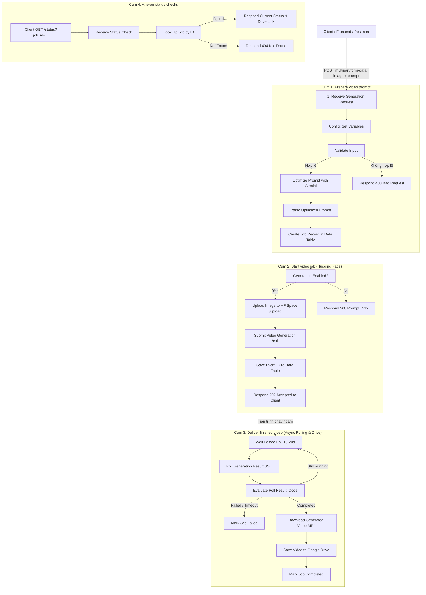

# TÀI LIỆU KỸ THUẬT & HƯỚNG DẪN WORKFLOW VIDEO 3
## Hệ Thống Tạo Video Du Lịch Tự Động Bằng AI (n8n × Google Gemini × Hugging Face Free × Google Drive)

> **Dự án**: AI Travel Reseller Network Platform  
> **Workflow**: Video 3 – Tự động tạo Cinematic Travel Video từ ảnh gốc (Image-to-Video)  
> **Phiên bản**: 2.0 (Chuyển đổi hoàn toàn từ Google Veo sang **Hugging Face Free Tier / ZeroGPU**)  
> **Nền tảng**: n8n Cloud / Self-hosted  
> **Ngày cập nhật**: 22/10/2026  

---

## MỤC LỤC
1. [Tổng Quan Hệ Thống](#1-tổng-quan-hệ-thống)
   - 1.1. Mục tiêu & Điểm nổi bật
   - 1.2. Tech Stack & Bảng so sánh Veo vs Hugging Face Free
2. [Kiến Trúc 4 Phân Khu Của Workflow](#2-kiến-trúc-4-phân-khu-của-workflow)
   - 2.1. Sơ đồ luồng xử lý
   - 2.2. Vòng đời trạng thái Job (State Machine)
3. [Chi Tiết Luồng Thực Thi Từng Node (Step-by-Step)](#3-chi-tiết-luồng-thực-thi-từng-node-step-by-step)
   - 3.1. Cụm 1: Prepare video prompt (Chuẩn bị & Tối ưu Prompt)
   - 3.2. Cụm 2: Start video job (Gọi Hugging Face Space Gradio API)
   - 3.3. Cụm 3: Deliver finished video (Wait & Polling SSE, Lưu Google Drive)
   - 3.4. Cụm 4: Answer status checks (API Truy vấn trạng thái)
4. [Cấu Hình & Thiết Lập Tham Số](#4-cấu-hình--thiết-lập-tham-số)
   - 4.1. Bảng biến toàn cục (Node Config)
   - 4.2. Hướng dẫn lấy Hugging Face Access Token & Chọn Space Free
5. [Đặc Tả Giao Tiếp API (API Specification & Postman)](#5-đặc-tả-giao-tiếp-api-api-specification--postman)
   - 5.1. API Khởi tạo Video (POST)
   - 5.2. API Tra cứu trạng thái & Lấy kết quả (GET)
6. [Xử Lý Lỗi Thường Gặp & Kinh Nghiệm Vận Hành](#6-xử-lý-lỗi-thường-gặp--kinh-nghiệm-vận-hành)

---

## 1. Tổng Quan Hệ Thống

### 1.1. Mục tiêu & Điểm nổi bật
Workflow n8n này đóng vai trò là một **RESTful API bất đồng bộ (Asynchronous Job Queue)** cho phép Client (Web app, App di động, Postman) gửi một bức ảnh địa điểm du lịch kèm mô tả ngắn để tự động tạo ra một đoạn video điện ảnh ngắn chất lượng cao.

- **Chi phí 0đ (100% Free)**: Sử dụng các mô hình tạo video mã nguồn mở (như LTX-Video, Wan 2.1/2.2) chạy trên nền tảng **Hugging Face Spaces (ZeroGPU Free Tier)**, không đòi hỏi thẻ tín dụng hay Google Cloud Billing.
- **Tối ưu Prompt thông minh**: Tận dụng Google Gemini (Free Tier) để phân tích bối cảnh bức ảnh và viết lại prompt thành mô tả chuyển động camera (drone pan, tilt, cinematic lighting, fps).
- **Kiến trúc Bất đồng bộ (Async Queue)**: Trả về HTTP `202 Accepted` kèm `job_id` trong vòng < 2 giây; tác vụ render nặng được chạy ngầm giúp tránh lỗi timeout webhook (504 Gateway Timeout).
- **Lưu trữ & Truy vấn tiện lợi**: File video MP4 tự động được lưu trữ an toàn trên Google Drive và cung cấp status API để Frontend kiểm tra trạng thái theo chu kỳ.

### 1.2. Tech Stack & So sánh Google Veo vs Hugging Face Free

| Tiêu chí | Google Veo (Phiên bản cũ) | Hugging Face Spaces (Phiên bản mới) |
| :--- | :--- | :--- |
| **Chi phí** | Bắt buộc liên kết Billing Google Cloud, tính phí theo giây video | **Hoàn toàn miễn phí (0 VNĐ)** với tài khoản Hugging Face |
| **Loại API** | Google Generative Language API (`predictLongRunning`) | Gradio Client API (`/upload`, `/call`, `/call/{event_id}`) |
| **Hạ tầng GPU** | Hạ tầng Google Cloud độc quyền | Hugging Face ZeroGPU (chia sẻ tài nguyên động miễn phí) |
| **Xác thực** | Google Gemini API Key | Hugging Face User Access Token (Read Permission) |
| **Mô hình AI** | Google Veo 2 / Veo 3 | LTX-Video, Wan 2.1, SVD (Stable Video Diffusion) |
| **Thời gian render** | 45s – 120s | 30s – 90s (tùy độ dài hàng đợi GPU) |

---

## 2. Kiến Trúc 4 Phân Khu Của Workflow

### 2.1. Sơ đồ luồng xử lý


### 2.2. Vòng đời trạng thái Job (State Machine)
- **`processing`**: Đã tiếp nhận yêu cầu, prompt đã tối ưu và job đã được nộp vào hàng đợi của Hugging Face Space.
- **`completed`**: Video đã render thành công, n8n đã tải về và lưu trữ an toàn trên Google Drive (kèm `video_url`).
- **`failed`**: Gặp lỗi ở bước tối ưu prompt, lỗi GPU Quota tại Hugging Face Space, hoặc quá số lần chờ (Timeout).

---

## 3. Chi Tiết Luồng Thực Thi Từng Node (Step-by-Step)

### 3.1. Cụm 1: Prepare video prompt (Chuẩn bị & Tối ưu Prompt)
1. **Receive Generation Request (Webhook POST)**:
   - Endpoint: `/webhook/travel-video/generate` (Test: `/webhook-test/travel-video/generate`)
   - Định dạng: `multipart/form-data`
   - Trường: `image` (tệp ảnh), `prompt` (mô tả yêu cầu).
2. **Config (Edit Fields / Set Node)**:
   - Khai báo các cấu hình tập trung để dễ dàng thay đổi mà không sửa từng node:
     - `gemini_model`: `gemini-2.5-flash`
     - `hf_space_url`: URL của Space trên Hugging Face (vd: `https://lightricks-ltx-video-distilled.hf.space`)
     - `hf_api_name`: Tên endpoint xử lý (vd: `generate_video` hoặc `predict`)
     - `poll_after_seconds`: `15` (giây)
     - `max_poll_attempts`: `30` (tối đa ~7.5 phút)
     - `generation_enabled`: `true`
3. **Validate Input & Input Valid? (Code & IF Node)**:
   - Kiểm tra `prompt` có rỗng không và tệp `image` có phải là định dạng hình ảnh hợp lệ (`image/jpeg`, `image/png`, `image/webp`).
4. **Optimize Prompt with Gemini (HTTP Request Node)**:
   - Gửi yêu cầu sang Gemini API để phân tích ảnh và sinh prompt chuyên nghiệp cho mô hình video:
   - **System Instruction**:
     ```text
     You are an expert travel cinematographer. Analyze the input image and enhance the user's travel prompt into a detailed cinematic prompt optimized for AI video generation (camera motion, drone view, lighting, reflections, natural movement).
     Return JSON only: { "optimized_prompt": "...", "negative_prompt": "..." }
     ```
5. **Parse Optimized Prompt (Code Node)**:
   - Bóc tách chuỗi JSON trả về từ Gemini, trích xuất `optimized_prompt` và `negative_prompt`.
6. **Create Job Record (Data Table Node)**:
   - Tạo mã công việc ngẫu nhiên: `job_` + timestamp (vd: `job_lz89q2x_109a`).
   - Ghi bản ghi vào Data Table với trạng thái: `processing`.

---

### 3.2. Cụm 2: Start video job (Gọi Hugging Face Space Gradio API)
Do Hugging Face Spaces sử dụng thư viện giao diện Gradio, quy trình gọi API không đồng bộ chuẩn gồm 2 bước:

1. **Upload Image to HF Space (HTTP Request Node)**:
   - **Method**: `POST`
   - **URL**: `{{ $("Config").first().json.hf_space_url }}/gradio_api/upload`
   - **Headers**:
     - `Authorization`: `Bearer {{ $credentials.huggingFaceToken }}`
   - **Body (Multipart/Form-Data)**:
     - `files`: Trỏ đến file nhị phân `image` của n8n.
   - **Response**: Trả về mảng đường dẫn file tạm trên server Hugging Face:
     ```json
     ["/tmp/gradio/45f8a023.../vinwonders-phu-quoc.jpg"]
     ```

2. **Submit Video Generation (HTTP Request Node)**:
   - **Method**: `POST`
   - **URL**: `{{ $("Config").first().json.hf_space_url }}/gradio_api/call/{{ $("Config").first().json.hf_api_name }}`
   - **Headers**:
     - `Authorization`: `Bearer {{ $credentials.huggingFaceToken }}`
     - `Content-Type`: `application/json`
   - **JSON Body**:
     ```json
     {{ JSON.stringify({
       "data": [
         {
           "path": JSON.parse($("Upload Image to HF Space").first().json.data)[0],
           "meta": { "_type": "gradio.FileData" }
         },
         $("Parse Optimized Prompt").first().json.optimized_prompt,
         $("Parse Optimized Prompt").first().json.negative_prompt || "blurry, distorted, low quality, static",
         $("Config").first().json.video_duration || 3
       ]
     }) }}
     ```
   - **Response trả về**:
     ```json
     {
       "event_id": "9a8b7c6d5e4f3a2b1c..."
     }
     ```

3. **Save Event ID & Respond Job Accepted (Data Table & Webhook Response)**:
   - Lưu `event_id` vào bản ghi Job trong Data Table.
   - Trả ngay HTTP `202 Accepted` cho Client kèm URL kiểm tra trạng thái (`status_url`).

---

### 3.3. Cụm 3: Deliver finished video (Wait & Polling SSE, Lưu Google Drive)
1. **Wait Before Poll (Wait Node)**:
   - Tạm dừng luồng ngầm `15 - 20 giây` trước khi kiểm tra trạng thái kết quả.
2. **Poll Generation Result (HTTP Request Node)**:
   - **Method**: `GET`
   - **URL**: `{{ $("Config").first().json.hf_space_url }}/gradio_api/call/{{ $("Config").first().json.hf_api_name }}/{{ $("Save Event ID").first().json.event_id }}`
   - **Response Format**: `Text` (Dữ liệu trả về là Server-Sent Events - SSE).
   - **Timeout**: `120000` ms (2 phút).
3. **Evaluate Poll Result (Code Node)**:
   - Đọc dữ liệu SSE stream trả về từ Hugging Face. Đoạn code xử lý chuẩn:
   ```javascript
   const raw = String($input.first().json.data || '');
   const attempt = ($runIndex || 0) + 1;
   const maxAttempts = $("Config").first().json.max_poll_attempts || 30;

   // Tìm các sự kiện trong luồng SSE
   const events = [...raw.matchAll(/event:\s*(\w+)\s*\r?\ndata:\s*(.*)/g)]
     .map(m => ({ event: m[1], data: m[2] }))
     .filter(e => e.event !== 'heartbeat');

   const lastEvent = events[events.length - 1];

   // Hàm đệ quy tìm link video .mp4 trong JSON kết quả
   function extractVideoUrl(obj) {
     if (!obj) return null;
     if (typeof obj === 'string' && (obj.endsWith('.mp4') || obj.includes('.mp4'))) return obj;
     if (Array.isArray(obj)) {
       for (const item of obj) {
         const res = extractVideoUrl(item);
         if (res) return res;
       }
     }
     if (typeof obj === 'object') {
       if (obj.url && String(obj.url).includes('.mp4')) return obj.url;
       if (obj.video && typeof obj.video === 'string') return obj.video;
       for (const key of Object.keys(obj)) {
         const res = extractVideoUrl(obj[key]);
         if (res) return res;
       }
     }
     return null;
   }

   let status = 'running';
   let videoUrl = null;
   let errorMessage = null;

   if (lastEvent) {
     if (lastEvent.event === 'complete') {
       try {
         const parsed = JSON.parse(lastEvent.data);
         videoUrl = extractVideoUrl(parsed);
         status = videoUrl ? 'completed' : 'failed';
         if (!videoUrl) errorMessage = 'Không tìm thấy file video trong kết quả Space';
       } catch (e) {
         status = 'failed';
         errorMessage = 'Lỗi parse JSON kết quả: ' + e.message;
       }
     } else if (lastEvent.event === 'error') {
       status = 'failed';
       errorMessage = lastEvent.data || 'Hugging Face Space báo lỗi (có thể do hết quota GPU)';
     }
   }

   if (status === 'running' && attempt >= maxAttempts) {
     status = 'failed';
     errorMessage = `Quá thời gian xử lý tối đa (${attempt} lần polling)`;
   }

   return [{
     json: {
       status,
       attempt,
       video_url: videoUrl,
       error_message: errorMessage
     }
   }];
   ```
4. **Route Poll Result (Switch Node)**:
   - Nhánh `running`: Nối ngược lại node **Wait Before Poll** để tiếp tục kiểm tra.
   - Nhánh `completed`: Chuyển sang node **Download Generated Video**.
   - Nhánh `failed`: Chuyển sang node **Mark Job Failed** để ghi nhận lỗi.
5. **Download Generated Video (HTTP Request Node)**:
   - Tải tệp video nhị phân từ `video_url` về n8n.
6. **Save Video to Google Drive (Google Drive Node)**:
   - Tải file MP4 lên thư mục chỉ định (`drive_folder_id`).
   - Lấy `webViewLink` và `webContentLink`.
7. **Mark Job Completed (Data Table Node)**:
   - Cập nhật bản ghi `status = completed`, lưu `drive_link` và thời gian hoàn thành.

---

### 3.4. Cụm 4: Answer status checks (API Truy vấn trạng thái)
1. **Receive Status Check (Webhook GET)**:
   - Endpoint: `/webhook/travel-video/status`
   - Query Parameter: `?job_id=...`
2. **Look Up Job (Data Table Node)**:
   - Truy vấn bản ghi theo `job_id`.
3. **Job Found? (IF Node)**:
   - **True**: Trả về thông tin trạng thái hiện tại (`processing`, `completed` kèm link Drive, hoặc `failed`).
   - **False**: Trả về HTTP `404 Not Found`.

---

## 4. Cấu Hình & Thiết Lập Tham Số

### 4.1. Bảng biến toàn cục (Node Config)

| Biến cấu hình | Kiểu dữ liệu | Giá trị mẫu | Ghi chú |
| :--- | :--- | :--- | :--- |
| `gemini_model` | String | `gemini-2.5-flash` | Model phân tích ảnh & viết prompt |
| `hf_space_url` | String | `https://lightricks-ltx-video-distilled.hf.space` | URL Space Hugging Face đang chạy |
| `hf_api_name` | String | `generate_video` | Tên hàm API trong Gradio (mục Use via API) |
| `video_duration` | Number | `3` | Thời lượng video (giây). 3-5s tối ưu tốc độ render |
| `poll_after_seconds` | Number | `15` | Thời gian nghỉ giữa các lần kiểm tra tiến độ |
| `max_poll_attempts` | Number | `30` | Tối đa số lần kiểm tra trước khi báo timeout |
| `generation_enabled` | Boolean | `true` | Bật/tắt gọi Hugging Face (dùng khi chỉ muốn test prompt) |
| `drive_folder_id` | String | `1vB_xxxxxxxxxxxxxxxx` | ID thư mục Google Drive lưu trữ kết quả |

### 4.2. Hướng dẫn lấy Hugging Face Access Token & Chọn Space Free
1. **Tạo Token Hugging Face**:
   - Đăng nhập [huggingface.co](https://huggingface.co/) → Vào **Settings** → **Access Tokens**.
   - Bấm **Create new token**, chọn loại **Read** (đủ quyền gọi inference và Space công khai).
   - Copy token (dạng `hf_xxxxxxxxxxxxxxxxxxxx`).
   - Trong n8n: Tạo Credential loại **Header Auth**:
     - *Name*: `Authorization`
     - *Value*: `Bearer hf_xxxxxxxxxxxxxxxxxxxx`
2. **Chọn Space Image-to-Video Free**:
   - Truy cập mục **Spaces** trên Hugging Face, tìm kiếm các Space có nhãn **ZeroGPU** (cung cấp GPU A100/H100 miễn phí trong vài chục giây cho mỗi lượt render).
   - Một số Space mã nguồn mở khuyến nghị:
     - `Lightricks/ltx-video-distilled`: Tốc độ cực nhanh (~15-30s), tốn ít quota.
     - `zerogpu-aoti/wan2-2-fp8da-aoti-faster`: Chuyển động chân thực, mượt mà.
   - **Lưu ý**: Luôn kéo xuống cuối trang Space, bấm **"Use via API"** để xác nhận chính xác `api_name` và thứ tự các tham số trong mảng `data`.

---

## 5. Đặc Tả Giao Tiếp API (API Specification & Postman)

### 5.1. API Khởi tạo Video (POST)
- **Endpoint (Production)**: `POST https://bdsadmin.app.n8n.cloud/webhook/travel-video/generate`
- **Endpoint (Test)**: `POST https://bdsadmin.app.n8n.cloud/webhook-test/travel-video/generate`
- **Content-Type**: `multipart/form-data`

#### Tham số Request:
| Trường | Kiểu | Bắt buộc | Mô tả |
| :--- | :--- | :--- | :--- |
| `image` | Binary File | Có | Tệp hình ảnh du lịch (JPG, PNG, WEBP) |
| `prompt` | String | Có | Yêu cầu mô tả chuyển động video từ người dùng |

#### Phản hồi thành công (HTTP 202 Accepted):
```json
{
  "success": true,
  "job_id": "job_lz89q2x_109a",
  "status": "processing",
  "message": "Video generation submitted to Hugging Face queue. Poll status_url for result.",
  "optimized_prompt": "Cinematic slow aerial drone forward push towards the vibrant sunlit amusement park castle, shimmering blue water reflections, lush swaying palm trees, crystal clear tropical sky, 4k ultra-realistic travel commercial style.",
  "status_url": "https://bdsadmin.app.n8n.cloud/webhook/travel-video/status?job_id=job_lz89q2x_109a",
  "poll_after_seconds": 15
}
```

---

### 5.2. API Tra cứu trạng thái & Lấy kết quả (GET)
- **Endpoint**: `GET https://bdsadmin.app.n8n.cloud/webhook/travel-video/status?job_id=job_lz89q2x_109a`

#### 1. Đang xử lý:
```json
{
  "success": true,
  "job_id": "job_lz89q2x_109a",
  "status": "processing",
  "message": "Video is currently rendering on Hugging Face GPU. Please check back in a few seconds."
}
```

#### 2. Hoàn tất thành công:
```json
{
  "success": true,
  "job_id": "job_lz89q2x_109a",
  "status": "completed",
  "video_url": "https://drive.google.com/file/d/1vB_example_file_id/view",
  "download_url": "https://drive.google.com/uc?id=1vB_example_file_id&export=download",
  "completed_at": "2026-10-22T15:05:30Z"
}
```

#### 3. Thất bại:
```json
{
  "success": false,
  "job_id": "job_lz89q2x_109a",
  "status": "failed",
  "error": "GPU quota exceeded on Hugging Face ZeroGPU. Please wait a few minutes or switch Space."
}
```

---

## 6. Xử Lý Lỗi Thường Gặp & Kinh Nghiệm Vận Hành

1. **Lỗi GPU Quota Exceeded trên Hugging Face**:
   - **Hiện tượng**: SSE trả về sự kiện `event: error` kèm thông báo `You have exceeded your GPU quota`.
   - **Giải pháp**:
     - Luôn kèm `Bearer Token` của tài khoản Hugging Face thay vì gọi ẩn danh (IP của server n8n dễ bị chặn nếu nhiều người cùng gọi).
     - Đặt `video_duration` ở mức `3 - 4 giây` để tiết kiệm thời gian cấp phát GPU.
     - Chuẩn bị sẵn 1 Space dự phòng (backup) trong node Config.
2. **Space rơi vào trạng thái Sleep (Ngủ đông)**:
   - Các Space miễn phí nếu không có tương tác sau 48-72h sẽ tự động Sleep.
   - Khi có request đầu tiên, Space mất khoảng 1-2 phút để "Wake up". Hãy cấu hình tính năng **Retry On Fail** trong node HTTP Request với `Tries: 2` và `Wait Between Tries: 30000ms`.
3. **Lưu ý kích hoạt Production Workflow trên n8n**:
   - Đảm bảo đã bật công tắc **Active / Publish** ở góc trên bên phải màn hình n8n.
   - Khi test với Postman, dùng URL `/webhook/...` (Production URL). Tránh dùng `/webhook-test/...` vì URL test chỉ lắng nghe được đúng 1 lần khi người quản trị nhấn nút "Listen for test event".
